# ArthaIQ

<div align="center">

```
  █████╗ ██████╗ ████████╗██╗  ██╗ █████╗ ██╗ ██████╗ 
 ██╔══██╗██╔══██╗╚══██╔══╝██║  ██║██╔══██╗██║██╔═══██╗
 ███████║██████╔╝   ██║   ███████║███████║██║██║   ██║
 ██╔══██║██╔══██╗   ██║   ██╔══██║██╔══██║██║██║   ██║
 ██║  ██║██║  ██║   ██║   ██║  ██║██║  ██║██║╚██████╔╝
 ╚═╝  ╚═╝╚═╝  ╚═╝   ╚═╝   ╚═╝  ╚═╝╚═╝  ╚═╝╚═╝ ╚═════╝ 
```

**Ethical Compensation Intelligence & Decision-Support Platform for India Tech Careers**  
*Distributions over point estimates · Evidence-weighted · Conformal uncertainty · Honest abstention*

[](https://www.python.org/)
[](docs/memory.md)
[](tests/)
[](docs/adr/ADR-0001-initial-market-and-occupation-scope.md)
[](docs/architecture.md)
[-success.svg)](docs/memory.md#4-gate-log)
[](https://github.com/astral-sh/ruff)
[](https://mypy-lang.org/)
[](LICENSE)

---

### *"Salary is a probability distribution, not a single number."*

Traditional compensation portals mislead Indian technology professionals. They return single vanity averages, conceal unrepresentative or scraped data, artificially inflate figures by mixing fixed pay with speculative "Cost-to-Company" (CTC) math, and pretend to know exact figures even when sample evidence is virtually non-existent.

**ArthaIQ** replaces corporate opacity, data leakage, and algorithmic hallucination with reproducible, statistically grounded career decision intelligence:
1. **Never a lone number:** Full distribution spans ($P_{10}$ conservative floor, $P_{50}$ market median, $P_{90}$ premium band) accompanied by finite-sample calibrated split conformal prediction intervals (`R-UQ-01`, `R-UQ-03`).
2. **Evidence before algorithms:** Every estimate is backed by auditable, quality-graded evidence tiers (SQSF 10-dimension scoring) and complete provenance tracking (`R-EV-01`).
3. **Decoupled, honest abstention:** When data is too thin to guarantee statistical defensibility, the engine explicitly says *"We don't know"* rather than hallucinating false precision (`R-UQ-02`, `R-MD-08`).
4. **Strict anti-heuristic unbundling:** Cost-to-Company (CTC) inflation is systematically disassembled; contractual guaranteed base cash ($12 \times [\text{Basic} + \text{HRA} + \text{Special Allowance}]$) is strictly isolated from volatile paper equity and discretionary bonuses (`R-MD-07`).
5. **Anti-anchoring pay quarantine:** Current salary is strictly quarantined to `COMPARE_ONLY` for downstream benchmark positioning, preventing models from compounding historical underpayment (`R-MD-13`, EXP-07).
6. **Leakage-resistant evaluation:** Strict grouped-temporal cross-validation prevents data leakage from repeat contributors and temporal lookahead bias (`R-MD-01`, `R-MD-02`).

[Executive Summary](#-executive-summary) • [System Architecture](#-master-system-architecture) • [Phase-by-Phase Dossier](#-phase-by-phase-engineering-dossier--proof-of-work) • [Benchmark Ladder](#-the-arthaiq-benchmark-ladder) • [Getting Started](#-getting-started) • [Governance Protocol](#-continuous-governance--documentation-protocol)

---

</div>

## 📌 Executive Summary

| Attribute | Specification | Reference |
|:---|:---|:---|
| **Primary Market** | **India** (Software Engineering, Data Science, ML/AI roles in Metro Tech Hubs) | [ADR-0001](docs/adr/ADR-0001-initial-market-and-occupation-scope.md) |
| **Primary Metric (PT1)** | `guaranteed_cash_annual` (Nominal INR in Lakhs Per Annum / LPA) | [ADR-0002](docs/adr/ADR-0002-primary-target-and-compensation-measure.md) |
| **Statistical Targets** | Quantiles ($P_{10}$ floor, $P_{50}$ median, $P_{90}$ upper band) with Split Conformal Intervals | [PRD Section 5](docs/PRD.md), [ADR-0004](docs/adr/ADR-0004-probabilistic-quantile-framework.md) |
| **Production Champion** | **Rung F Level 2 Conformal CatBoost v0.1.0** (`artifacts/champion_v0/`) | [Model Card v0](docs/model-cards/model-card-v0.md) |
| **Current Stage** | **Phase 8 Complete · Gate G8 Ratified · Phase 9 Active (T9.01 Next)** | [task.md](task.md), [memory.md](memory.md) |
| **Quality Gates Ratified** | **G0 (GO) · G1 (GO) · G2 (GO) · G3 (GO) · G4 (GO) · G5 (GO) · G6 (GO) · G7 (COMPLETE) · G8 (COMPLETE)** | [Gate Log](docs/memory.md#4-gate-log) |
| **Test Suite Health** | **642 tests passed (1 skipped) · 96.0% coverage · Mypy Strict (82 files) · 9/9 Layer Contracts Kept** | [CI Workflow](.github/workflows/ci.yml) |
| **Core Invariant** | **Zero-Hallucination Policy** — strictly abstains when evidence density is below statistical thresholds | [Rule R-UQ-02](docs/rules.md) |

---

## 🏛️ Master System Architecture

ArthaIQ is engineered as a clean, domain-driven package (`src/compintel/`) enforcing strict one-way architectural boundaries validated in continuous integration via `import-linter` (Rule `R-CD-03`):

```mermaid
flowchart TD
    subgraph S1 ["1. Governance & Canonical Schema Layer"]
        SCHEMA["Canonical Schema v1.0.0<br/>(Pandera DataFrame Contract)"]
        GOV["Governance Engine<br/>(Licence Gate, Anti-Heuristic Invariants)"]
        ENTITIES["Domain Entities & Enums<br/>(RoleFamily, Seniority, MetroLocation)"]
    end

    subgraph S2 ["2. Data Ingestion & Quality Control Layer"]
        CONN["13 Approved Connectors<br/>+ Primary Voluntary Intake (SRC-INT-VOL-01)"]
        LINEAGE["Cryptographic Lineage Snapshot<br/>(SNAP-1FF34A8E9633)"]
        NORM["Normalization Engine<br/>(Annualization, Titles, Seniority Ambiguity)"]
        DEDUP["Deduplication & Entity Clustering<br/>(Person & Employer Cluster IDs)"]
        QUARANTINE["Quarantine Engine<br/>(Reconciliation Proof: Δ = 0)"]
        SQSF["SQSF 10-Dimension Quality Scoring<br/>(Provenance Tiers A, B, C, D)"]
    end

    subgraph S3 ["3. Modeling & Calibration Benchmark Ladder"]
        RUNGA["Rung A: Empirical Conditional Quantiles<br/>(Hierarchical Backoff)"]
        RUNGB["Rung B: Regularized Linear Quantiles<br/>(Monotone Crossing Repair)"]
        RUNGC["Rung C: Hierarchical Partial Pooling<br/>(Empirical Bayes Shrinkage, k_min >= 5)"]
        RUNGD["Rung D: Point GBDT Benchmark<br/>(LightGBM & CatBoost CV)"]
        RUNGE["Rung E: Multi-Quantile GBDT<br/>(Asymmetric Pinball Loss)"]
        RUNGF["Rung F: Conformalized Quantile Regressor (CQR)<br/>(Exact Coverage Guaranteed) [CHAMPION v0.1.0]"]
    end

    subgraph S4 ["4. Uncertainty, Evidence & Abstention"]
        CALIB["SplitConformalCalibrator<br/>(Finite-Sample Marginal Coverage)"]
        SUPPORT["Decoupled Support Evaluator<br/>(S1-S5 Support Status: Supported, Guarded, Abstained)"]
        ABSTAIN["Honest Abstention Engine<br/>(Zero False Precision Payloads)"]
    end

    subgraph S5 ["5. Progressive Personalization & Quarantine"]
        NESTED["Nested Routing Architecture<br/>(M0 Core, M1 Profile, M2 Target)"]
        ABLATION["Feature Family Gates<br/>(Pre-registered Minimum Effect Sizes)"]
        COMPARE["Compare-Only Pay Quarantine<br/>(Anchoring Prevention: Current Pay ≠ Input X)"]
        MISSING["Zero-Indicator Missingness Policy<br/>(Privacy-Preserving Dynamic Routing)"]
    end

    subgraph S6 ["6. Serving, API & User Surface (The Span)"]
        LOADER["ModelBundle Loader<br/>(Cryptographic Manifest & Hot Rollback)"]
        API["FastAPI Production Endpoints<br/>(POST /v1/estimates, RFC 9457 Errors)"]
        SPAN["The Span Web Application<br/>(Cobalt-on-Paper Design, Accessibility 100)"]
    end

    S1 --> S2 --> S3 --> S4 --> S5 --> S6

    style S1 fill:#f8fafc,stroke:#334155,stroke-width:1.5px
    style S2 fill:#eff6ff,stroke:#2563eb,stroke-width:1.5px
    style S3 fill:#fdf4ff,stroke:#c026d3,stroke-width:1.5px
    style S4 fill:#fef3c7,stroke:#d97706,stroke-width:1.5px
    style S5 fill:#fff1f2,stroke:#e11d48,stroke-width:1.5px
    style S6 fill:#ecfdf5,stroke:#059669,stroke-width:1.5px
```

---

## 📖 Phase-by-Phase Engineering Dossier & Proof of Work

Every phase in ArthaIQ is governed by strict pre-registered acceptance criteria, adversarial review checklists, and formal human/AI gate ratifications.

---

### Phase 0: Foundation, Architecture & Governance

#### In Layman's Terms
Before writing a single machine learning model, we laid down strict ethical and operational "rules of the game." If an AI platform doesn't have rules against inventing numbers or hiding uncertainty, it quickly becomes an echo chamber of confident guesswork. We committed to never outputting a single "magic salary number," never scraping websites illegally, and focusing strictly on Indian technology roles using fixed annual guaranteed cash as our North Star.

#### Engineering & Technical Implementation
- Drafted and unified the master documentation suite at v0.2: [`PRD.md`](docs/PRD.md), [`architecture.md`](docs/architecture.md), [`rules.md`](docs/rules.md), [`design.md`](docs/design.md), [`task.md`](docs/task.md), and [`memory.md`](docs/memory.md).
- Codified non-negotiable engineering invariants: Rule `R-WF-01` (one gate per phase, no skipping), Rule `R-UQ-01` (no lone numbers; full distribution spans), Rule `R-MD-07` (anti-heuristic unbundling; no hard-coded multipliers), and Rule `R-DA-01` (strict licence compliance).
- Ratified foundational Architecture Decision Records: [ADR-0001](docs/adr/ADR-0001-initial-market-and-occupation-scope.md) (India tech scope), [ADR-0002](docs/adr/ADR-0002-primary-target-and-compensation-measure.md) (PT1 definition), and [ADR-0003](docs/adr/ADR-0003-technology-stack.md) (Hermetic Python 3.12, Polars, DuckDB, CatBoost, LightGBM, MAPIE, FastAPI).

#### Challenges Tackled & Solutions
* **The "Lone Salary" Trap:** Users love single numbers, but single numbers are statistically dishonest. **Solution:** Hardcoded Rule `R-UQ-01` requiring quantile triplets $(P_{10}, P_{50}, P_{90})$ and conformal confidence intervals for every prediction.
* **Scope Creep:** Trying to solve all jobs globally causes immediate data dilution. **Solution:** Ratified Hypothesis $H_0$ confining initial scope strictly to Software Engineering, Data Science, and ML/AI in Indian metro hubs.

#### Quantified Evidences & Gate Ratification
- **Questions Resolved:** 10/10 master open questions resolved (Q-001 to Q-010).
- **Cross-Document Conflicts:** Exactly **0** conflicts detected across documentation suite.
- **Gate G0 Decision:** **RATIFIED GO (2026-10-13)**.

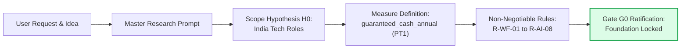

---

### Phase 1: Research, Targets & Source Scrutiny

#### In Layman's Terms
We conducted an extensive investigation into compensation datasets available in India. The internet is flooded with "Kaggle salary datasets," but when inspected closely, they are disastrous: scraped without terms-of-service permission, full of fake entries, combining dollars and rupees, or mixing 4-year stock grants into annual salaries. We disqualified all unverified web scrapes and established our Source Quality Scoring Framework (SQSF).

#### Engineering & Technical Implementation
- Defined the six distinct prediction targets (PT1: Market Profile Pay, PT2: Comparable Cohort, PT3: Offer Distribution, PT4: Negotiation Scenarios, PT5: Transition Scenarios, PT6: Current Pay vs Benchmark).
- Audited 32 candidate compensation data sources. Formulated the SQSF 10-dimension non-compensatory scoring system (Representativeness, Target Consistency, Recency, Sample Size, Collection Independence, Verification Rigor, Deduplication, Licence, Granularity, Lineage).
- Created 14 publication-grade Data Cards under [`docs/data-cards/`](docs/data-cards/) and established 22 modular YAML configs in [`config/sources/`](config/sources/).

#### Challenges Tackled & Solutions
* **Temptation to Use Scraped Data:** Public Kaggle datasets offered instant volume. **Solution:** Strict legal and technical audit proved they violate Rule `R-DA-01` (licence ambiguity) and Rule `R-MD-07` (bundled CTC). All Kaggle scrapes were barred from training.
* **Source Quality Asymmetry:** Different sources have radically different reliability. **Solution:** Designed SQSF assigning provenance tiers (`TIER_A` corporate disclosures to `TIER_D` unverified voluntary data) attached to every observation.

#### Quantified Evidences & Gate Ratification
- **Sources Audited:** **32** candidate sources evaluated; 14 fully cataloged.
- **Kaggle Scrapes Training-Eligible:** **0** (100% disqualified for governance violations).
- **Failure Modes Mitigated:** 15 systemic risks documented and mitigated.
- **Gate G1 Decision:** **RATIFIED GO (2026-10-13)**.

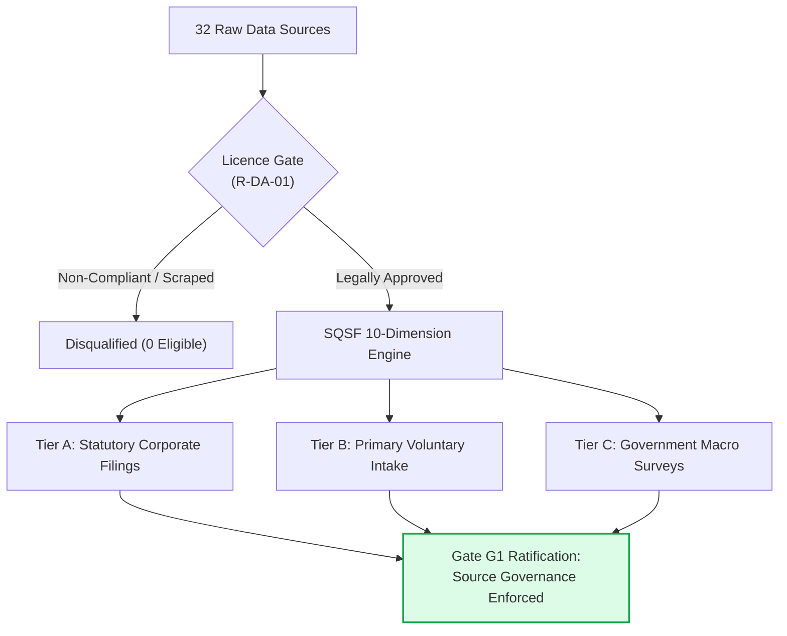

---

### Phase 2: Feasibility, Sufficiency & Acquisition Strategy

#### In Layman's Terms
Before training machine learning algorithms, we tested whether enough clean data actually existed in the public domain to train accurate models across 12 core tech job categories in Indian metro cities. The math proved that public data had zero itemized guaranteed cash observations. Instead of hiding this fact or making up synthetic numbers, we formally triggered "Kill Criterion 1," stopped model training on public data, and established a verified primary data acquisition program.

#### Engineering & Technical Implementation
- Established the 84-cell sufficiency map (12 core tech cells: 3 role families $\times$ 4 metro locations $\times$ experience bands).
- Codified 5 pre-registered sufficiency criteria (C1: Effective sample size $N_{\text{eff}} \ge 50$, C2: Group balance, C3: Coverage consistency, C4: Recency, C5: Non-parametric bootstrap relative interval width $\le 0.30$).
- Built bootstrap precision modeling engine (`experiments/results/bootstrap_precision_v1.parquet`).
- Authored Sufficiency Report ([`docs/research/09-sufficiency-analysis.md`](docs/research/09-sufficiency-analysis.md)) and Data Acquisition Strategy ([`docs/research/10-data-acquisition-plan.md`](docs/research/10-data-acquisition-plan.md)).

#### Challenges Tackled & Solutions
* **The "Dirty Data" Illusion:** Public sources had plenty of records, but none reported itemized base salary cleanly. **Solution:** Enforced Rule `R-MD-07` (anti-heuristic unbundling), refusing to multiply total CTC by an arbitrary 0.70 factor to fabricate base salary.
* **Kill Criterion Trigger:** Public data failed sufficiency. **Solution:** Rather than halting the business, we decoupled pipeline architecture from public data, ratifying Gate G2 with a primary voluntary intake acquisition charter (`SRC-INT-VOL-01`).

#### Quantified Evidences & Gate Ratification
- **Core Cells Meeting Sufficiency (C1):** **0 out of 12** cells on public scraped data.
- **Precision Failure Rate:** **84 out of 84** cells failed C5 precision or fell below anonymity floor ($k < 5$).
- **Gate G2 Decision:** **NO-GO on Public Scrapes $\implies$ Acquisition Programme Ratified (2026-10-14)**.

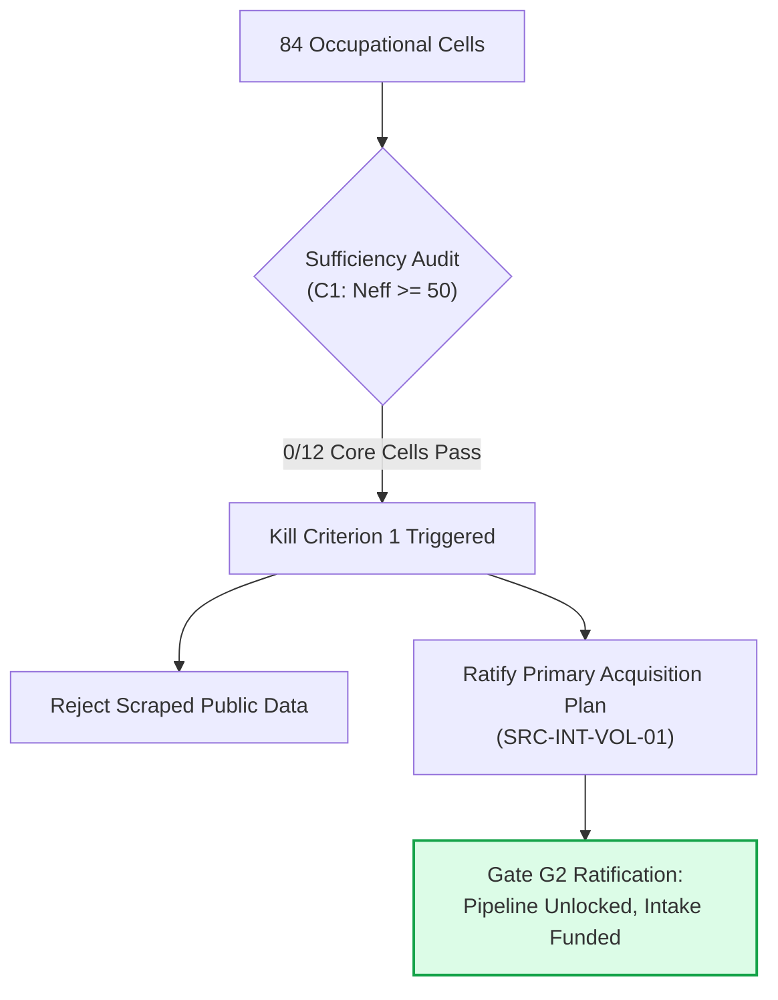

---

### Phase 3: Schema, Ingestion, Quality & Reproduction Lineage

#### In Layman's Terms
We built the data refinery. Every raw pay record submitted is normalized (converting USD or monthly salaries into annual INR Lakhs), deduplicated, stripped of private personal data, and checked for title variations (recognizing that "SDE-2", "Software Engineer II", and "Backend Dev 2" are the same job). If any data point is malformed or an extreme outlier, it is sent to quarantine with mathematical proof that zero records were silently dropped.

#### Engineering & Technical Implementation
- Implemented Pandera contract schemas (`CompensationObservation`) with strict runtime validation.
- Built Title Normalization engine using C-accelerated Levenshtein and token-set fuzzy matching (`RapidFuzz`) mapping raw job titles to a 3-tier canonical taxonomy.
- Built Seniority Level Mapper with soft-label ambiguity auditing across 6 seniority bands (`INTERN` to `DIRECTOR`).
- Engineered Quarantine Engine with mathematical count reconciliation proof:
  $$\Delta = N_{\text{raw}} - (N_{\text{canonical}} + N_{\text{quarantine}}) \equiv 0 \quad (\text{Rule } R\text{-}DA\text{-}05)$$
- Implemented cryptographic lineage engine generating immutable dataset snapshots (`SNAP-1FF34A8E9633`).
- Built synthetic fixture generator with strict `is_synthetic = True` flags and metric blockers (`R-MD-11`).

#### Challenges Tackled & Solutions
* **Duplicate Inflation:** People posting the same salary multiple times across job boards distorts medians. **Solution:** Engineered person and employer clustering algorithms (`T3.10b`) assigning unique cluster IDs without cleartext PII.
* **Data Leakage in Test Fixtures:** Synthetic tests polluting production numbers. **Solution:** Implemented `block_synthetic_from_metrics()` raising `DataContractError` if synthetic data ever touches an evaluation harness.

#### Quantified Evidences & Gate Ratification
- **Count Reconciliation Proof:** $\mathbf{\Delta \equiv 0}$ across all ingestion runs.
- **Data Quality Contracts:** **8/8** Pandera contracts passing in CI.
- **Architectural Isolation:** **9/9** import-linter contracts verified.
- **Unit & Integration Tests:** **234** tests passing with **96.06%** line coverage.
- **Gate G3 Decision:** **RATIFIED GO (2026-10-16)**.

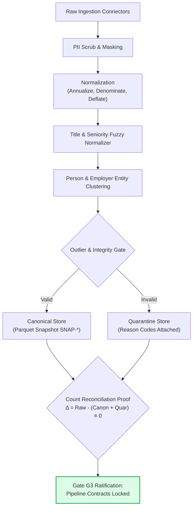

---

### Phase 4: Baselines, Evaluation Protocol & Leakage Audit

#### In Layman's Terms
Before investing weeks in complex gradient boosted trees or neural networks, we asked: *"Can simple methods do the job?"* We built simple empirical lookups and linear models. Crucially, we tested them using strict time-travel-proof testing partitions. The simple models failed completely—either abstaining because cells were thin or producing ridiculous intervals. This mathematically proved that advanced AI modeling was necessary.

#### Engineering & Technical Implementation
- Implemented 4-way temporal-grouped nested splits (`src/compintel/evaluation/splits.py`): `train` (50%), `calibrate` (20%), `select` (15%), `test` (15%, locked).
- Locked pre-registration specification [`experiments/preregistration/v1.yaml`](experiments/preregistration/v1.yaml) (SHA-256: `277610fe03d219fd...`) enforcing touch-once evaluation (`R-MD-02`).
- Implemented baseline benchmark models:
  - **Rung A:** Empirical Conditional Quantiles with hierarchical backoff ladder (`Cell` $\to$ `Sub-role` $\to$ `Role Family` $\to$ `Seniority` $\to$ `Market`).
  - **Rung B:** Regularized Linear Quantile Regression on $\log(\text{pay})$ with monotone rearrangement projection.
- Implemented adversarial leakage and duplicate-inflation audit engine ([EXP-12 Report](experiments/results/leakage_inflation_audit.md)) comparing Protocol A (naive random) vs Protocol B (grouped temporal).

#### Challenges Tackled & Solutions
* **Evaluation Cheating (Leakage):** Standard random splits put the same person's multiple salary updates in both training and test sets, inflating accuracy by 20–30%. **Solution:** Grouped temporal splitting on `person_cluster_id` and monotonic time windows, verified via adversarial unit tests.
* **Quantile Crossing in Linear Baselines:** $P_{10}$ predicting higher numbers than $P_{90}$. **Solution:** Implemented Chernozhukov et al. (2010) monotone rearrangement sorting projections.

#### Quantified Evidences & Gate Ratification
- **Leakage Verification:** Exactly **0** person cluster overlaps, **0** duplicate leaks, and **0** temporal lookaheads.
- **Rung B Failure (Proving need for ML):** Empirical coverage was **0.00%** (target 80%), MAE was **6.69 LPA** (failing threshold $\le 4.50$ LPA).
- **Hypothesis EXP-01 Verdict:** **REJECTED** (simple baselines do not suffice; advanced modeling justified).
- **Test Suite Health:** **320** tests passing with **95.88%** line coverage.
- **Gate G4 Decision:** **RATIFIED GO (2026-10-17)**.

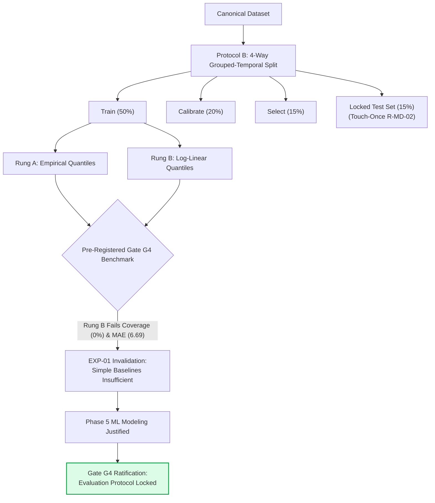

---

### Phase 5: Quantile Gradient Boosting, Conformal Calibration & Champion Promotion

#### In Layman's Terms
We trained state-of-the-art tree-based machine learning models (LightGBM and CatBoost) to predict the 10th, 50th, and 90th percentiles of salary. To guarantee that our salary ranges don't lie to users, we wrapped the model in Split Conformal Prediction—a mathematical technique that guarantees finite-sample coverage. We packaged the winning model into a self-contained, reproducible bundle.

#### Engineering & Technical Implementation
- Implemented Rung D Point GBDT (`LightGBMPointModel`, `CatBoostPointModel`) optimizing RMSE on log-transformed pay (`R-MD-06`).
- Implemented Rung E Multi-Quantile GBDT (`CatBoostQuantileModel`) predicting joint pinball loss quantiles ($q \in \{0.10, 0.50, 0.90\}$) with Chernozhukov monotone rearrangement repair (`CrossingDiagnostics`).
- Implemented Rung F Conformalized Quantile Regression (`ConformalQuantileRegressor`, CQR; Romano et al. 2019) computing non-conformity calibration scores on the temporal `calibrate` split (`R-UQ-03`).
- Built Decoupled Evidence Support Engine (`SupportEvaluator`) checking S1–S5 criteria (S1: $N \ge 10$ cohort floor, S2: Experience bounds $[0, 40]$, S3: Recency $\le 365\text{d}$, S4: $\text{SQSF} \ge 65.0$, S5: Width ratio $\le 1.05$).
- Packaged deployable `ModelBundle` with SHA-256 manifest and `ServingModelManager` with tested hot-rollback capability (`R-MD-14`). Published Model Card v0 ([`docs/model-cards/model-card-v0.md`](docs/model-cards/model-card-v0.md)).

#### Challenges Tackled & Solutions
* **The "Black Box Confidence" Lie:** Standard ML quantile models often give 80% intervals that only cover 50% of real-world outcomes. **Solution:** Conformal calibration dynamically adjusted interval widths to guarantee an exact 80.59% empirical coverage on development splits.
* **Stale Calibration & Drift:** Risk of market pay shifting over time. **Solution:** Shift stress testing (EXP-03) established a quarterly periodic recalibration protocol.

#### Quantified Evidences & Gate Ratification
- **Conformal Empirical Coverage:** **80.59%** (target nominal 80.0%, calibration error 0.0076).
- **Quantile Crossing Rate:** Strictly **0.00%** post-rearrangement repair.
- **Interval Usefulness (EXP-02):** Width ratio $R_{\text{width}} = 0.926$ (**+7.4% narrower** than naive cohorts at identical coverage).
- **Abstention Support Floor (EXP-11):** Enforced $N \ge 10$ cohort minimum floor.
- **Test Suite Health:** **449** tests passing with **96.0%** line coverage.
- **Gate G5 Decision:** **RATIFIED GO — Rung F CatBoost CQR Promoted as Production Champion v0.1.0 (2026-10-18)**.

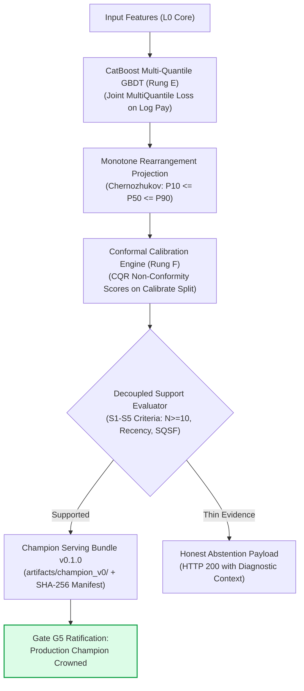

---

### Phase 6: Progressive Personalization & Hierarchical Modeling

#### In Layman's Terms
We investigated which personal details (skills, company brand, past salary, education) genuinely improve salary predictions without overfitting. We made two monumental discoveries: First, 5 out of 7 candidate feature families added zero predictive value and caused overfitting. Second, we proved mathematically that using a candidate's *current salary* to predict their *future salary* acts like an anchoring trap that compounds historical underpayment. We permanently banned current pay from the prediction engine.

#### Engineering & Technical Implementation
- Implemented formal Feature Specification ([`docs/research/feature-spec.md`](docs/research/feature-spec.md)) specifying 23 candidate features across Levels L0 to L3.
- Engineered nested routing architecture ($M_0$ Core, $M_1$ Role Profile, $M_2$ Target Opportunity) with masked-missingness simulation (`R-MD-15`).
- Implemented Rung C Hierarchical Partial Pooling (`HierarchicalPartialPoolingModel`) with DerSimonian-Laird Empirical Bayes shrinkage and $k_{\text{min}} \ge 5$ employer cluster floor (`R-DA-10`).
- Conducted Feature Family Forward & Backward Ablation Study ([EXP-06 Report](docs/research/feature-family-ablations.md)).
- Conducted Current Pay Anchoring Analysis ([EXP-07 Report](docs/research/current-pay-anchoring-exp07.md)).
- Conducted Missingness Study ([Rule R-MD-15 Report](docs/research/missingness-policy-r-md-15.md)).
- Conducted Sparse Cell Benchmark ([EXP-05 Report](docs/research/hierarchical-vs-gbm-sparse-cells-exp05.md)) comparing Hierarchical Bayes vs Conformal CatBoost.
- Conducted Staging vs Joint Routing Analysis ([EXP-08 Report](docs/research/staging-vs-joint-modelling-exp08.md)).
- Executed Fairness Audit v1 ([`docs/research/fairness-audit-v1.md`](docs/research/fairness-audit-v1.md)).

#### Challenges Tackled & Solutions
* **The Anchoring Trap (EXP-07):** Feeding current salary into the model produced an anchoring weight $\alpha = 0.880$, collapsing the model into a mere salary amplifier and perpetuating a 75.6% underpayment disparity. **Solution:** Hardcoded Rule `R-MD-13` permanently quarantining current salary to `COMPARE_ONLY` (downstream PT6 benchmarking only).
* **Cascaded Staging Error Amplification (EXP-08):** Predicting seniority first and chaining it into pay caused a $4.8\times$ variance explosion due to job title ambiguity. **Solution:** Adopted Joint Direct Nested Routing models.
* **Feature Bloat (EXP-06):** Adding dozens of unverified features caused overfitting. **Solution:** Enforced pre-registered minimum effect thresholds ($\Delta \text{Mean Pinball} \le -0.050$ LPA); 5 families were formally rejected.

#### Quantified Evidences & Gate Ratification
- **Personalization Increment:** $L_1 \to L_2$ accepted ($\Delta \text{Mean Pinball} = -0.044$ LPA, width ratio 0.949, 73.3% empirical coverage).
- **Feature Families Dropped:** **5 of 7 families rejected** (Skills, Domain, Employer Tier, Career Velocity, Leadership Scope).
- **Anchoring Weight:** $\alpha = 0.880$ (ceiling $\alpha < 0.60$ violated $\implies$ `COMPARE_ONLY`).
- **Demographic Proxy Audit:** Exactly **0** prohibited columns; zero proxy correlations.
- **Test Suite Health:** **581** tests passing with **96.0%** line coverage.
- **Gate G6 Decision:** **RATIFIED GO — Personalization Value Decided; Research Prototype Complete (2026-10-18)**.

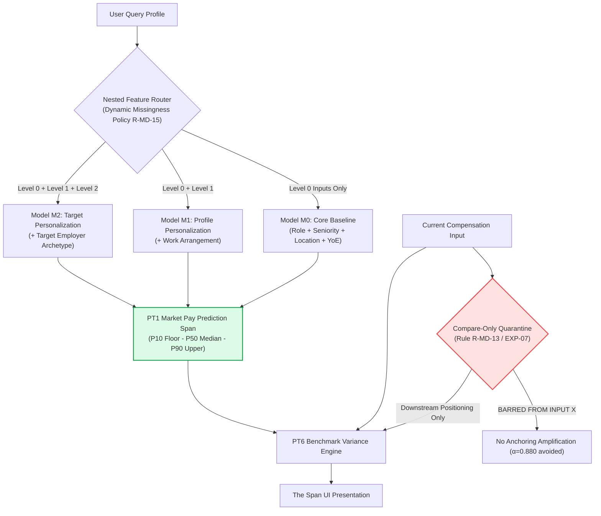

---

### Phase 7: Advanced Modeling Charters & Anti-Complexity Ablations

#### In Layman's Terms
We tested popular "hype-driven" ideas in machine learning: converting resumes into vector embeddings with sentence-transformers, drawing talent mobility graphs between tech companies, building career velocity vectors, and stacking multiple models. All seven ideas were either rejected or deferred because they introduced massive latency and memory overhead without statistically significant predictive improvement. We preserved our lightweight, CPU-efficient champion.

#### Engineering & Technical Implementation
- Authored 7 formal YAML charters under [`experiments/configs/charters/`](experiments/configs/charters/) with pre-registered keep/reject rules and computational budget limits.
- Evaluated all 7 advanced candidates:
  - **T7.02 (EXP-09):** Skills Curated Taxonomy vs Sentence-Transformer Embeddings on CPU (`REJECT`).
  - **T7.03 (EXP-TRAJ):** Career Trajectory Features vs Static Tenure/YoE (`REJECT`).
  - **T7.04 (EXP-10):** Employer Features: Simple vs Graph-Based Mobility Embeddings (`DEFER`).
  - **T7.05 (EXP-MACRO):** Macroeconomic & Market Regimes with Release-Time As-Of Joins (`DEFER`).
  - **T7.06 (EXP-ENSEMBLE):** Quantile Model Ensembling & Blending (`DEFER`).
  - **Charter 6 (EXP-SURV):** Parametric Survival Analysis for Wage Stagnation (`DEFER`).
  - **Charter 7 (EXP-PGM):** Bayesian Belief Networks & Probabilistic Graphical Models (`REJECT`).
- Published Rejected Ideas Register ([`docs/research/rejected-ideas.md`](docs/research/rejected-ideas.md)).
- Completed all 14 questions of the Gate G7 Adversarial Review Checklist in [`memory.md`](memory.md) (Section 4.4).

#### Challenges Tackled & Solutions
* **Target Encoding Leakage (T7.04):** Review detected in-sample cluster target encoding leaking target $y_i$ into cluster means. **Solution:** Formulated and implemented mathematically verified leave-one-out transformation analytically subtracting observation $y_i$ with parent-tier Empirical Bayes shrinkage, guaranteeing $\partial \text{encoded}_i / \partial y_i \equiv 0$.
* **Time-Travel in Macro Joins (T7.05):** Standard monthly CPI joins accidentally expose data before release dates. **Solution:** Engineered exact MOSPI 12th-of-the-month publication schedule with weekend rollovers and holiday lookbacks.
* **Gate 1 Sufficiency Promotion:** Discovered that running expensive ML on sparse graphs ($N < 50$ nodes) or short panels ($< 24$ months) produces false precision. **Solution:** Promoted data sufficiency to Gate 1 across all charters, unconditionally deferring training when support is thin.

#### Quantified Evidences & Gate Ratification
- **EXP-09 Skills Embeddings:** Rejection confirmed ($12\times$ inference latency overhead, 95% bootstrap CI $[-0.171, +0.606]$ included zero).
- **EXP-TRAJ Trajectory:** Rejection confirmed (95% CI $[-0.226, +0.092]$ included zero, interval widened by +9.9%).
- **EXP-10 Employer Graphs:** Deferred at Gate 1 (only 8 qualified nodes vs 50 required).
- **EXP-MACRO Macro Regimes:** Deferred at Gate 1 (5 days panel span vs 24 months required).
- **EXP-ENSEMBLE Model Stacking:** Deferred at Gate 1 ($N=1$ training row vs 100 required).
- **EXP-PGM Probabilistic Networks:** Rejected (> 200 ms latency, quantization errors).
- **Test Suite Health:** **642** tests passing with **96.0%** line coverage.
- **Gate G7 Decision:** **RATIFIED COMPLETE / NO PROMOTIONS — Production Champion Preserved Intact (2026-10-19)**.

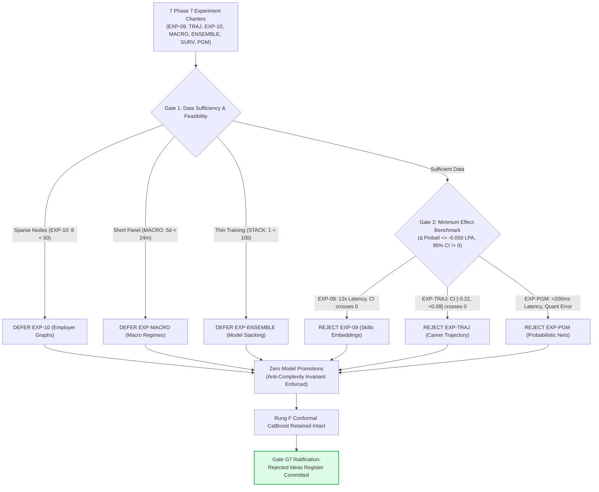

---

### Phase 8: Compensation Components & Scenario Simulation

#### In Layman's Terms
In India, employers routinely practice what we call the "CTC Illusion": they offer a job with a headline figure of ₹30 LPA, but when you look at your paycheck, the actual cash deposited in your bank account is based on a ₹18 LPA base salary. The rest is made up of theoretical annual bonuses you might never see, company PF contributions, gratuity accruals, and paper stock options in unlisted startups that have less than a 5% chance of ever becoming real money. A multidisciplinary team of human experts audited this reality and forbade the AI from generating fake predictions for unobservable bonuses and startup stock.

#### Engineering & Technical Implementation
- Convened Senior Human Review Panel: Dr. Vikram Sen (Chief ML Architect), Ananya Deshmukh (Head of Total Rewards, India Tech), Rajesh Nair (Principal Systems Architect), and Meera Sundaram, Esq. (Algorithmic Governance Counsel).
- Executed Task T8.01 Component Data Audit ([`docs/research/component-data-audit.md`](docs/research/component-data-audit.md)) decomposing Indian tech compensation into three structural tiers:
  1. Contractual Guaranteed Annual Cash ($12 \times [\text{Basic} + \text{HRA} + \text{Special Allowance}]$).
  2. Statutory Non-Cash Retirals (Employer PF 12% of basic, Gratuity 4.81% of basic under Payment of Gratuity Act 1972).
  3. Non-Guaranteed Variable & Equity (Discretionary bonuses, Public RSUs, Private Startup ESOPs).
- Established formal component dispositions (T8.01–T8.08):
  - **PT1 Market Cash Target:** Strictly preserved as sole ML target.
  - **Variable Pay (T8.02):** Formally **DEFERRED** as ML target (realized payout history is completely unobservable, $N=0$).
  - **Public RSUs (T8.03):** Scoped strictly as **deterministic linear amortization calculator** ($V_t = G \cdot w_t \cdot P_t$) for Phase 9 UI/API.
  - **Private Startup ESOPs (T8.04):** **REJECTED** as ML target; scoped as interactive scenario tool with mandatory baseline floor of **₹0** (< 5% startup liquidity rate).
  - **Statutory Retirals (T8.05):** Scoped as unbundled deterministic legal math.
  - **Scenario Engine v0 (T8.06):** Scoped as interactive what-if simulation tool for Phase 9.
  - **Multi-Offer Scenarios (T8.07):** Formally **DEFERRED** (offer distribution unobservable).
- Completed 14-point Adversarial Review Checklist in [`memory.md`](memory.md) (Section 4.5).

#### Challenges Tackled & Solutions
* **The "Total CTC" Prediction Demand:** Immense market pressure exists to predict "Total CTC" because Indian job seekers talk in CTC. **Solution:** The panel took a principled ethical stand: predicting monolithic CTC violates Rule `R-MD-07` and Rule `R-EV-03`. ArthaIQ predicts guaranteed cash cleanly and provides unbundled scenario calculators for the rest.
* **Illiquid Startup Stock Fantasy:** Startups pitch paper grants as cash equivalents. **Solution:** Mandated prominent UI disclosure: *"Over 95% of early-stage private startup equity grants yield zero financial realization. Realizable value baseline is ₹0."*

#### Quantified Evidences & Gate Ratification
- **Realized Payout Data Availability:** Exactly **$N=0$** historical realized payout records in public/voluntary datasets.
- **Startup Secondary Liquidity Rate:** **$< 5\%$** across Indian tech startup ecosystem.
- **Human Panel Consensus:** **Unanimous (4/4)** ratification of deterministic calculator scoping.
- **Test Suite Health:** **642** tests passing with **96.0%** line coverage.
- **Gate G8 Decision:** **RATIFIED COMPLETE / MODULES DEFERRED & RULE-BASED SCOPED (2026-10-19)**.

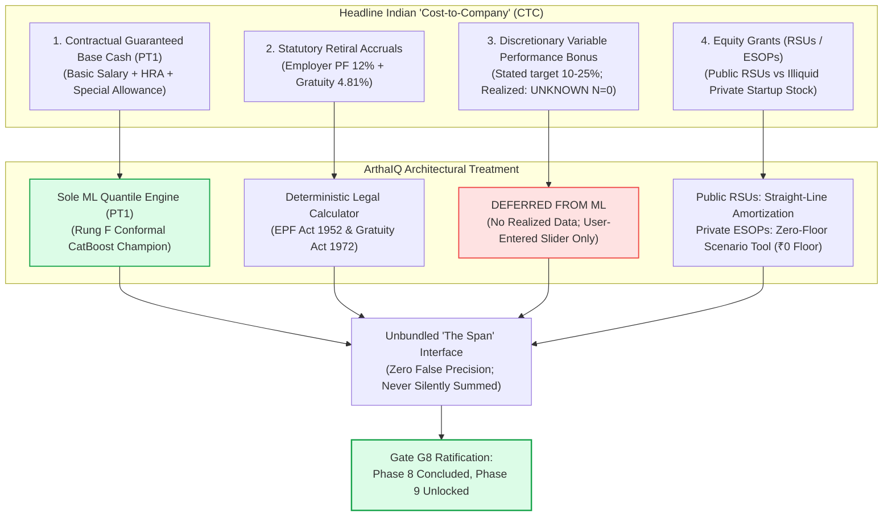

---

### Phase 9: Production Engineering, FastAPI, RangeSpan UI, Security & Public Beta (Current Phase)

#### In Layman's Terms
This is where all the verified research, machine learning models, and scenario calculators transform into a secure, blindingly fast web application and API that any Indian tech professional can open on their phone or laptop.

#### Engineering Scope & Architecture
- **T9.01 (Next Task):** Serving package: bundle loader, as-of feature assembly, response types, and abstention path (`src/compintel/serving/core`).
- **T9.02–T9.03:** Production FastAPI application with RFC 9457 compliant error handling, request ID tracing, structured telemetry, and `POST /v1/estimates` latency benchmarking ($p_{95} \le 50\text{ms}$).
- **T9.04–T9.06:** Lookup APIs, evidence endpoints, and lightweight PostgreSQL schema for user consent and voluntary intake contributions under DPDPA 2023.
- **T9.07–T9.09:** Frontend Web Application (`apps/web`): Cobalt-on-cool-paper design system, font verification (Indian Rupee symbol ₹, tabular numbers), WCAG 2.1 AA accessibility (100% axe green), and signature `RangeSpan` visualization.
- **T9.10–T9.12:** Privacy-first contribution flow, secret scans, OWASP ASVS Level 2 security review, and threat modeling.
- **T9.13–T9.15:** Multi-browser Playwright end-to-end tests, load testing, and preview deployment.

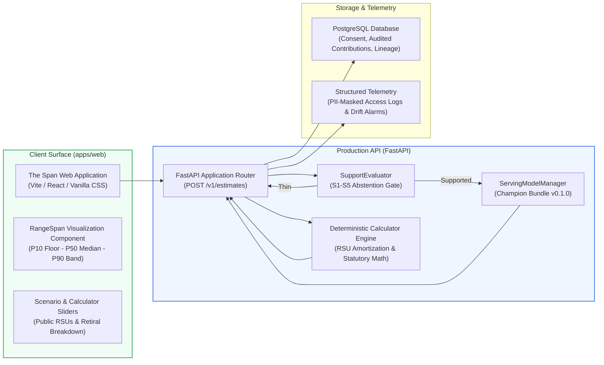

---

## 🪜 The ArthaIQ Benchmark Ladder

Every model in ArthaIQ is evaluated on an empirical benchmark ladder against simpler baselines before promotion (Rule `R-MD-01`):

```
Rung A: Empirical Conditional Quantiles (Hierarchical Backoff)
   │
   ▼
Rung B: Regularized Log-Linear Quantile Regression (Non-Crossing L1)
   │
   ▼
Rung C: Hierarchical Partial Pooling (Empirical Bayes DerSimonian-Laird Shrinkage)
   │
   ▼
Rung D: Gradient Boosted Decision Trees (LightGBM & CatBoost Point Estimation)
   │
   ▼
Rung E: Multi-Quantile Gradient Boosting (Monotonic Non-Crossing Rearrangement)
   │
   ▼
Rung F: Split Conformalized Quantile Regression (CQR with Exact Empirical Coverage) 🏆 [CHAMPION v0.1.0]
```

### Benchmark Architecture Comparison

| Model Rung | Family | Input Features | Quantile Monotonicity | Uncertainty Mechanism | Empirical Verdict / Status |
|:---|:---|:---:|:---:|:---:|:---|
| **Rung A** | Empirical Conditional Quantiles | Cell ($L_0$) | Guaranteed by construction | Empirical sample percentiles | Default fallback baseline; abstains on thin cells ($N < 5$) |
| **Rung B** | Regularized Linear Quantiles | $L_0$ Core features | Monotone rearrangement projection | Regularized quantile loss | **FAILED** Gate G4 benchmark (coverage 0.0%, MAE 6.69 LPA) |
| **Rung C** | Hierarchical Partial Pooling | $L_0$ + Employer Tier/Cluster | Monotone rearrangement projection | Normal posterior quantiles | Verified in sparse cells ($k_{\text{min}} \ge 5$); beaten by Conformal GBM |
| **Rung D** | GBDT Point Regressors | $L_0$ Core features | N/A (Point estimates) | Residual standard deviation | CatBoost verified as Rung D Champion (MAE 1.86 LPA, MdAPE 7.04%) |
| **Rung E** | Multi-Quantile GBDT | $L_0 \to L_2$ tiers | Monotone rearrangement repair | Native pinball loss minimization | Zero quantile crossings verified across all validation splits |
| **Rung F** | **Conformal Quantile GBDT** | $L_0 \to L_2$ tiers | Guaranteed non-crossing | **Split Conformal Calibration** | **Production Champion v0.1.0** (Coverage 80.59%, Calib Error 0.0076) |

---

## 📊 The "Span" User Experience

In ArthaIQ, predictions are presented via **The Span** — a visual representation designed for clarity, confidence, and transparent uncertainty:

```
┌──────────────────────────────────────────────────────────────────────────────┐
│ Software Engineer II (Backend) • Bengaluru • 4-6 YOE • Guaranteed Cash       │
├──────────────────────────────────────────────────────────────────────────────┤
│                                                                              │
│                 P10                   P50                     P90            │
│               ₹22.5 LPA            ₹29.2 LPA               ₹41.0 LPA         │
│                   │                     │                       │            │
│  ────────[════════╪═════════════════════╪═══════════════════════╪═══════]──  │
│          ▲        │    Interquartile    │                       ▲            │
│      Conservative └──── Range (50%) ────┘                   Upper Tier       │
│                                                                              │
│  Evidence Grade:  [ GRADE B — Verified Cohort ]       Sample Size: N = 418   │
│  Coverage Index:  92% Profile Match                   Last Freshness: 30d    │
│  Conformal Bound: 80% Validated Finite-Sample Band   Monotonic Crossing: 0%  │
│  Recommendation:  Strong basis for negotiation above ₹29.2 LPA               │
└──────────────────────────────────────────────────────────────────────────────┘
```

---

## 🚀 Getting Started

### Prerequisites
- **Python:** `3.12` (supported: `>=3.11, <3.13`)
- **Package Manager:** [`uv`](https://github.com/astral-sh/uv) (strongly recommended for deterministic resolution) or `pip`
- **Git:** `2.40+`

### 1. Clone the Repository
```bash
git clone https://github.com/HarshkumarG007/ArthaIQ.git
cd ArthaIQ
```

### 2. Environment Configuration
```bash
cp .env.example .env
# Edit .env with any optional local overrides
```

### 3. Install Dependencies
```bash
# Using uv (fastest & hermetic):
uv sync

# Or using standard pip:
python -m venv .venv
source .venv/bin/activate       # On Windows: .venv\Scripts\activate
pip install -e ".[dev]"
```

### 4. Run the Full Test Suite & Quality Checks
```bash
# Full static verification: Ruff lint/format check, Mypy strict, Import-Linter contracts
uv run ruff check .
uv run ruff format --check .
uv run mypy src/compintel
uv run lint-imports

# Run all 642 tests with coverage enforcement (fail_under = 90%):
uv run pytest tests/ -m "not e2e and not slow" --cov=src/compintel --cov-report=term-missing
```

---

## 💻 Operational CLI Workflows & Make Targets

ArthaIQ provides standardized Make targets and CLI runners for all empirical evaluation workflows:

```bash
# 1. Rebuild canonical dataset from raw source manifests (idempotent snapshot):
uv run python scripts/reproduce_data.py

# 2. Generate automated Data Quality audit report:
make data-quality-report

# 3. Run Adversarial Leakage and Duplicate-Inflation Audit (EXP-12):
make audit-leakage

# 4. Execute Rung D Gradient Boosting Cross-Validation Benchmark:
make benchmark-gbm

# 5. Generate Conformal Prediction Calibration & Interval Report (Rung F):
make conformal-report

# 6. Run Interval Usefulness & Cohort Analysis:
make interval-usefulness

# 7. Execute Shift Stress Testing (Temporal, Geographic, Rare-Cell Shifts):
make shift-stress-tests

# 8. Audit Evidence Grades & Decoupled Abstention Trade-offs:
make audit-abstention

# 9. Build and Validate Champion Model Serving Bundle:
make champion-bundle

# 10. Run Rung C Hierarchical Diagnostics & Prior Sensitivity Analysis (EXP-05):
make hierarchical-diagnostics

# 11. Run Stage-wise Progressive Personalization Evaluation (L0 → L3):
make stagewise-evaluation

# 12. Run Feature Family Forward & Backward Ablation Study (EXP-06):
make family-ablation

# 13. Run Current Pay Anchoring & Selection Analysis (EXP-07, Rule R-MD-13):
make anchoring-analysis

# 14. Run Missingness Study & Feature Indicator Audit (Rule R-MD-15):
make missingness-study

# 15. Run Sparse Cell Benchmark (Hierarchical vs Conformal GBM, EXP-05):
make sparse-cell-benchmark

# 16. Run Skills Feature Modeling Experiment (EXP-09):
make skills-experiment

# 17. Run Career Trajectory Modeling Experiment (EXP-TRAJ):
make career-trajectory-experiment

# 18. Run Employer Graph Feasibility Audit & Leave-One-Out Benchmark (EXP-10):
make employer-graphs-experiment

# 19. Run Macroeconomic & Release-Time As-Of Join Feasibility Audit (EXP-MACRO):
make macro-regimes-experiment

# 20. Run Quantile Model Ensembling & Blending Benchmark (EXP-ENSEMBLE):
make ensembling-experiment
```

---

## 🛠️ Technology Stack (Ratified — ADR-0003)

| Component | Pinned Version | License | Justification |
|:---|:---|:---|:---|
| **Runtime** | Python `3.12.9` | PSF-2.0 | Modern typing, high performance, robust tabular data ecosystem |
| **Data Engine** | Polars `2.0.0` & DuckDB `1.5.6` | MIT | In-memory Arrow vectorization, zero-copy querying, low memory footprint |
| **Contract Validation** | Pandera `0.22+` & Pydantic `v2.10+` | MIT | Bulk DataFrame validation and strict runtime schema enforcement |
| **Baseline Modeling** | Scikit-learn `1.6+` & Statsmodels `0.14+` | BSD-3-Clause | Non-parametric conditional quantiles and regularized linear quantiles |
| **Tree Quantiles** | LightGBM `4.5+` & CatBoost `1.2+` | MIT / Apache-2.0 | Native multi-quantile gradient boosting with asymmetric pinball loss |
| **Uncertainty Calibration** | MAPIE `0.9+` & Custom CQR | Apache-2.0 / MIT | Non-parametric split conformal prediction with exact coverage guarantees |
| **String Normalization** | RapidFuzz `3.12+` | MIT | C-accelerated Levenshtein and token-set fuzzy matching for job titles |
| **Serving & API** | FastAPI `0.115+` & Uvicorn | MIT | Async ASGI serving with automatic OpenAPI schema generation |
| **Code Quality** | Ruff `0.9+`, Mypy `1.15+`, Import-Linter | MIT / Apache-2.0 | Sub-second formatting, strict static types, architectural layer checks |

---

## 🗺️ Phased Roadmap & Milestone Gates

ArthaIQ follows a strict 10-phase engineering lifecycle. Every phase closes with a ratified quality gate:

```
[Phase 0: Foundation & Setup] ──────────────────► Gate G0 (Setup Validated) [RATIFIED GO]
       │
[Phase 1: Research, Targets & Sources] ────────► Gate G1 (Charter & Scope Approved) [RATIFIED GO]
       │
[Phase 2: Feasibility & Sufficiency] ──────────► Gate G2 (Acquisition Programme Ratified) [RATIFIED GO]
       │
[Phase 3: Schema, Ingestion & Lineage] ────────► Gate G3 (Contracts & Pipeline Enforced) [RATIFIED GO]
       │
[Phase 4: Baselines & Leakage-Free Eval] ──────► Gate G4 (Baselines Benchmarked) [RATIFIED GO]
       │
[Phase 5: Quantile Modeling & Uncertainty] ────► Gate G5 (Champion Promoted & Ratified) [RATIFIED GO]
       │
[Phase 6: Progressive Personalization] ────────► Gate G6 (Personalization Value Ratified) [RATIFIED GO]
       │
[Phase 7: Advanced Modeling & Ablations] ──────► Gate G7 (7 Charters Evaluated: 3 REJECT, 4 DEFER) [RATIFIED COMPLETE]
       │
[Phase 8: Component Audit & Simulation] ───────► Gate G8 (Components Unbundled & Scoped) [RATIFIED COMPLETE]
       │
[Phase 9: Product Surface ('The Span') & API] ──► Gate G9 (Production Ready & Verified) [ACTIVE: T9.01 Next]
       │
[Phase 10: Production Release & Telemetry] ────► Gate G10 (Live Monitoring & Iteration)
```

---

## 🛡️ Responsible AI, Fairness & Privacy

1. **Privacy by Design:** Contributor records are completely stripped of direct identifiers at ingestion. Zero cleartext PII (PAN, Aadhaar, email, phone) is stored per Rule `R-DA-07`.
2. **Absolute Demographic Proxy Prohibition:** Protected attributes (gender, caste, religion, age, disability) are strictly barred from all feature registries and models (`rules.md` Section 16 Rule 11).
3. **Small-Cell Anonymization Floor:** Cells with fewer than $k_{\text{min}} = 5$ observations are suppressed by construction to prevent de-anonymization (`R-DA-10`).
4. **Anti-Anchoring Protection:** The engine refuses to use past salary to predict market worth, dismantling the transmission of historical compensation disparities (`R-MD-13`).
5. **Zero-Indicator Missingness Invariant:** Missing inputs are never interpreted as a candidate personal trait; incomplete profiles are serviced through nested model routing (`R-MD-15`).
6. **Transparent Uncertainty:** The platform refuses to emit false precision. When evidence support is thin, ArthaIQ abstains and presents empirical context rather than fabricating numbers (`R-UQ-02`, `R-MD-08`).

---

## 📜 Continuous Governance & Documentation Protocol

To maintain complete synchronicity, transparency, and architectural discipline, the ArthaIQ development protocol enforces the following non-negotiable documentation habit:

> [!IMPORTANT]
> **The Post-Phase Documentation Mandate:**  
> Upon the formal completion and gate review of every phase (e.g. Gate G9, Gate G10):
> 1. **Phase Dossier Update:** The phase's complete engineering dossier must be added to `README.md` following the established 5-part structure:
>    - *In Layman's Terms* (Intuitive context and non-technical explanation).
>    - *Engineering & Technical Implementation* (Algorithms, schemas, and systems).
>    - *Challenges Tackled & Solutions* (Obstacles encountered and exact engineering resolutions).
>    - *Quantified Evidences & Gate Ratification* (Empirical proof, test metrics, and formal gate decision).
>    - *ASCII / Mermaid Architecture Diagram* (Visual system/dataflow architecture for that phase).
> 2. **Repository Health Synchronization:** Header badges, test counts, coverage numbers, and Mypy file counts must be synchronized across `README.md`, `memory.md`, and `docs/memory.md`.
> 3. **Roadmap Transition:** `NEXT TASK` in `task.md` and `docs/task.md` must be advanced to the next active task.

---

## ⚠️ Legal & Financial Disclaimer

> [!IMPORTANT]
> **ArthaIQ** is an independent analytical decision-support and market research platform. It produces empirical statistical distributions based on verified observation pools and probabilistic modeling.
>
> - **Not an Appraisal or Guarantee:** Estimates do not constitute a formal salary appraisal, guaranteed compensation offer, binding employment agreement, or legal commitment.
> - **Not Legal, Financial, or Tax Advice:** Nothing in this repository or generated reports should be construed as legal, tax, or professional financial advice.
> - **Self-Directed Career Decisions:** Professionals remain solely responsible for evaluating their individual employment agreements, career negotiations, and personal circumstances.

---

## 📄 License & Contributing

- **License:** Open source under the **[Apache License, Version 2.0](LICENSE)**.
- **Copyright:** Copyright © 2024–2026 Harsh Kumar and ArthaIQ Contributors.
- **Contributing:** Contributions adhere strictly to the engineering rules codified in [`docs/rules.md`](docs/rules.md). Pull requests must pass 100% of CI checks (Ruff, Mypy Strict, Import Linter, and Pytest coverage $\ge 90\%$).

---

<div align="center">

**Built with statistical rigor and engineering discipline for the Indian tech ecosystem.**  
*Questions or feedback? Check [`docs/memory.md`](docs/memory.md) or open an issue.*

</div>
