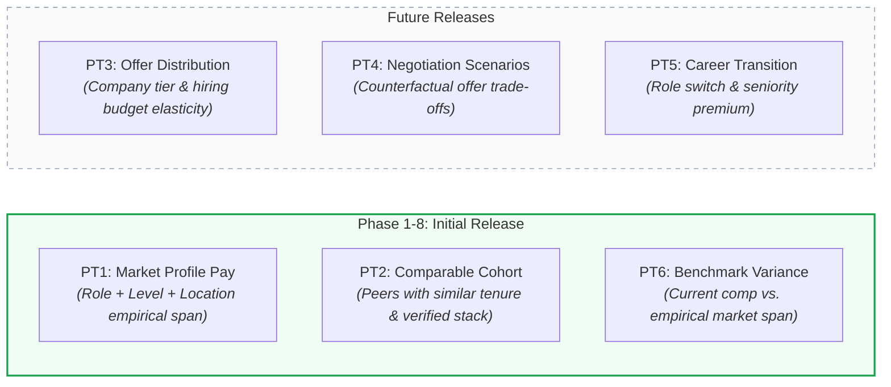
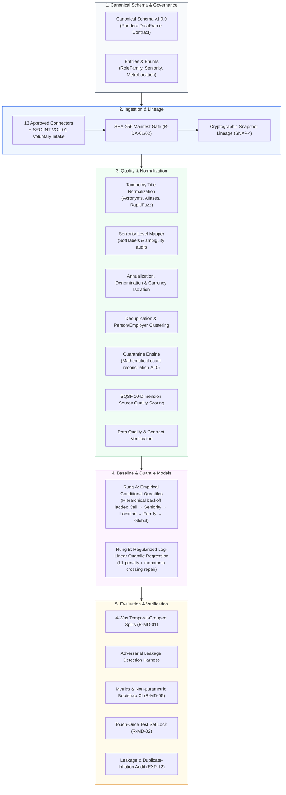

# ArthaIQ

<div align="center">

```
  █████╗ ██████╗ ████████╗██╗  ██╗ █████╗ ██╗ ██████╗
 ██╔══██╗██╔══██╗╚══██╔══╝██║  ██║██╔══██╗██║██╔═══██╗
 ███████║██████╔╝   ██║   ███████║███████║██║██║   ██║
 ██╔══██║██╔══██╗   ██║   ██╔══██║██╔══██║██║██║   ██║
 ██║  ██║██║  ██║   ██║   ██║  ██║██║  ██║██║╚██████╔╝
 ╚═╝  ╚═╝╚═╝  ╚═╝   ╚═╝   ╚═╝  ╚═╝╚═╝  ╚═╝╚═╝ ╚═════╝
```

**Ethical Compensation Intelligence & Decision-Support Platform for India Tech Careers**
*Distributions over point estimates · Evidence-weighted · Transparent uncertainty · Honest abstention*

[](https://www.python.org/)
[](docs/memory.md)
[](tests/)
[](docs/adr/ADR-0001-initial-market-and-occupation-scope.md)
[](docs/architecture.md)
[](https://github.com/astral-sh/ruff)
[](https://mypy-lang.org/)
[](LICENSE)

---

### *"Salary is a probability distribution, not a single number."*

Traditional compensation portals return a single misleading average, conceal unrepresentative data sources, inflate numbers using bundled CTC tricks, and pretend to know what you are worth even when evidence is virtually non-existent.

**ArthaIQ** replaces guesswork and corporate opacity with reproducible, statistically grounded career intelligence:
1. **Never a lone number:** Full distribution spans ($P_{10}$ conservative floor, $P_{50}$ market median, $P_{90}$ premium band) accompanied by uncertainty bounds.
2. **Evidence before algorithms:** Every estimate is backed by auditable, quality-graded evidence tiers (SQSF 10-dimension scoring) and complete provenance tracking.
3. **Honest abstention:** When data is too thin to guarantee statistical defensibility, the engine explicitly says *"We don't know"* rather than hallucinating false precision.
4. **Strict anti-heuristic unbundling:** Cost-to-Company (CTC) inflation is strictly disassembled; guaranteed base cash ($12 \times [\text{Basic} + \text{HRA} + \text{Special Allowance}]$) is isolated from volatile paper equity and discretionary bonuses.
5. **Leakage-resistant evaluation:** Strict grouped-temporal cross-validation prevents data leakage from repeat contributors and temporal lookahead bias.

[Explore Documents](#-documentation-index) • [Core Philosophy](#-core-principles--invariants) • [Architecture](#-system-architecture) • [Roadmap](#-phased-roadmap--quality-gates) • [Quickstart](#-getting-started)

---

</div>

## 📌 Executive Summary

| Attribute | Specification | Reference |
|:---|:---|:---|
| **Primary Market** | **India** (Software Engineering, Data Science, ML/AI roles) | [ADR-0001](docs/adr/ADR-0001-initial-market-and-occupation-scope.md) |
| **Primary Metric** | `guaranteed_cash_annual` (Nominal INR in Lakhs Per Annum / LPA) | [ADR-0002](docs/adr/ADR-0002-primary-target-and-compensation-measure.md) |
| **Statistical Targets** | Quantiles ($P_{10}$ conservative floor, $P_{50}$ market median, $P_{90}$ upper band) | [PRD Section 5](docs/PRD.md) |
| **Target Audience** | Tech professionals benchmarking pay, evaluating offers, or planning career transitions | [PRD Section 3](docs/PRD.md) |
| **Current Stage** | **Phase 4 — Baselines and Leakage-Resistant Evaluation** | [task.md](task.md), [memory.md](memory.md) |
| **Quality Gates Ratified** | **Gate G0 (GO)** · **Gate G1 (GO)** · **Gate G2 (GO on Acquisition)** · **Gate G3 (GO)** | [Gate Log](docs/memory.md#4-gate-log) |
| **Test Suite Health** | **293 tests passing · 96.32% line coverage · Mypy Strict · 9/9 Layer Contracts Kept** | [CI Workflow](.github/workflows/ci.yml) |
| **Core Invariant** | **Zero-Hallucination Policy** — strictly abstains when evidence density is below statistical thresholds | [Rule R-UQ-02](docs/rules.md) |

---

## 💡 The Problem & The ArthaIQ Standard

### The Reality of Tech Compensation in India
- **Information Asymmetry:** Corporate HR teams possess proprietary survey benchmarks (Mercer, Aon Hewitt), while candidates rely on unweighted forum anecdotes or self-selected job board aggregations.
- **CTC Distortion:** Indian job offers bundle gratuity, employer provident fund (PF), retention clawbacks, and multi-year unvested paper equity into an inflated single headline figure ("CTC").
- **Company Tier Variance:** Compensation spread across Indian IT service providers, mid-market product companies, Global Capability Centers (GCCs), and Tier-1 product/HFT firms can exceed 400% for identical years of experience.

### Conventional Tools vs. The ArthaIQ Standard

| Dimension | Conventional Compensation Portals | The ArthaIQ Standard |
|:---|:---|:---|
| **Representation** | Single point estimate (*"Your market salary is ₹28 LPA"*)| **Probabilistic span** (*"₹22.5 LPA floor — ₹29.2 LPA median — ₹41.0 LPA top tier"*) |
| **Uncertainty** | Zero uncertainty; claims false exactness | **Explicit confidence intervals** via non-parametric bootstrap & conformal calibration |
| **Data Integrity** | Black-box scraping; unverified submissions | **SQSF 10-Dimension Quality Scoring** with verified provenance metadata attached to every row |
| **Thin Data** | Always predicts a number even with $N=1$ observation | **Strict Abstention Policy** — explicitly withholds estimates when evidence is thin |
| **Pay Measure** | Blended CTC aggregate hiding variable compensation | **Itemized Guaranteed Cash** ($12 \times [\text{Basic} + \text{HRA} + \text{Special Allowance}]$) |
| **Evaluation** | Naive random splits that leak contributor data | **4-Way Temporal-Grouped Splits** with adversarial leakage detection |

---

## 🎯 Prediction Targets (PT1 – PT6)

ArthaIQ maintains strict mathematical and conceptual separation across six distinct prediction targets:



---

## ⚖️ Core Principles & Invariants

Every line of code and statistical procedure adheres to the strict rules codified in [`docs/rules.md`](docs/rules.md):

1. **No Skipping Steps (Rule R-WF-01):** Pipeline stages are sequential: `IDEA → RESEARCH → SPEC → PIPELINE → BASELINES → MODELS → SERVING`.
2. **Evidence Before Algorithms (Rule R-EV-01):** Validated data cleaning, canonical schema contracts, and provenance tracking precede any ML model.
3. **Distributions, Never Lone Numbers (Rule R-UQ-01):** Every estimate outputs $P_{10}$, $P_{50}$, $P_{90}$, uncertainty bounds, and limitations.
4. **Honest Abstention (Rule R-UQ-02 / R-MD-08):** When evidence is thin ($N_{\text{eff}} < 50$ or out-of-distribution experience), predictions are withheld with an explicit `abstention_reason`.
5. **No Hard-Coded Multipliers (Rule R-MD-07):** Location, role, and tier adjustments must be empirically learned from data, never populated with arbitrary rules of thumb.
6. **Strict Anti-Heuristic Unbundling (Rule R-MD-07):** Bundled CTC without itemized breakdown is strictly quarantined from PT1 training.
7. **Leakage-Resistant Splits (Rule R-MD-01 / R-MD-02):** Zero contributor cluster overlap across partitions; final holdout test set is evaluated exactly once at release gate under lock.
8. **Synthetic Data Isolation (Rule R-MD-11):** Synthetic fixtures are strictly for plumbing and testing; metrics from synthetic data are blocked from production reports.
9. **No Silent Drops (Rule R-DA-05):** Every raw record must be mathematically accounted for: $\Delta = \text{Total} - (\text{Valid} + \text{Quarantined}) == 0$.

---

## 📊 The "Span" User Experience

In ArthaIQ, predictions are presented via **The Span** — a visual representation designed for clarity, confidence, and transparent uncertainty:

```
┌──────────────────────────────────────────────────────────────────────────────┐
│ Software Engineer II (Backend) • Bengaluru • 4-6 YOE • Guaranteed Cash       │
├──────────────────────────────────────────────────────────────────────────────┤
│                                                                              │
│                 P10                   P50                     P90            │
│               ₹22.5 LPA            ₹29.2 LPA               ₹41.0 LPA         │
│                   │                     │                       │            │
│  ────────[════════╪═════════════════════╪═══════════════════════╪═══════]──  │
│          ▲        │    Interquartile    │                       ▲            │
│      Conservative └──── Range (50%) ────┘                   Upper Tier       │
│                                                                              │
│  Evidence Grade:  [ GRADE B — Verified Cohort ]       Sample Size: N = 418   │
│  Coverage Index:  92% Profile Match                   Last Freshness: 30d    │
│  Recommendation:  Strong basis for negotiation above ₹29.2 LPA               │
└──────────────────────────────────────────────────────────────────────────────┘
```

---

## 🏛️ System Architecture

ArthaIQ is engineered as a modular, domain-driven package (`src/compintel/`) enforcing strict one-way dependency boundaries verified by `import-linter` (Rule `R-CD-03`):



---

## 📁 Repository Tour

```text
arthaiq/
├── docs/                               # Project documentation suite (v0.2 unified)
│   ├── PRD.md                          # Product Requirements Document (Ratified v1.0)
│   ├── architecture.md                 # System architecture, domain layers, import boundaries
│   ├── design.md                       # Design philosophy, "The Span" visual specs, typography
│   ├── rules.md                        # Non-negotiable engineering invariants and ML ethics
│   ├── task.md                         # 10-phase milestone task breakdown and roadmap
│   ├── memory.md                       # Living project memory, decision logs, session history
│   ├── adr/                            # Architecture Decision Records (ADR-0001 to ADR-0009)
│   ├── data-cards/                     # 14 data cards for all audited compensation sources
│   ├── quality/                        # Automated Data Quality audit reports
│   └── research/                       # Feasibility, sufficiency, autopsy, premortem reports
├── config/                             # Catalogs, source terms, and thresholds
│   ├── sources/                        # 22 YAML source configurations (licence, routing, field maps)
│   └── thresholds.yaml                 # Preregistered evaluation & sufficiency thresholds
├── data/                               # Local data zone (STRICTLY GITIGNORED per Rule R-DA-08)
│   ├── raw/                            # Immutable raw data stores with committed manifest.yaml
│   ├── canonical/                      # Reproduced canonical dataset & cryptographic lineage
│   └── quarantine/                     # Reconciled quarantine stores with reason codes
├── experiments/                        # Experiment tracking and evaluation deliverables
│   ├── preregistration/                # Locked YAML pre-registrations (v1.yaml, SHA-256 hashed)
│   ├── configs/                        # One YAML per experiment configuration
│   └── results/                        # Evaluation metrics, audit JSONs, and markdown reports
├── src/compintel/                      # Core Python production package
│   ├── schema/                         # Canonical observation schemas, Pandera contracts, enums
│   ├── governance/                     # Licence verification and data access controls
│   ├── ingestion/                      # Approved source connectors, manifest audits, lineage
│   ├── quality/                        # Profiler, coverage, sufficiency, dedup, quarantine, SQSF
│   ├── normalization/                  # Currency, CPI deflation, annualization, titles, levels
│   ├── models/baselines/               # Rung A (empirical backoff), Rung B (regularized log-linear)
│   └── evaluation/                     # Splits, leakage detection, metrics, lock, inflation audit
├── tests/                              # Multi-tier automated test suite (293 passing)
│   ├── unit/                           # Isolated component unit tests
│   ├── property/                       # Hypothesis property-based tests
│   ├── contract/                       # Pandera schema and API contract verifications
│   ├── leakage/                        # Adversarial seeded leakage detection tests
│   ├── integration/                    # Multi-stage pipeline integration tests
│   └── fixtures/                       # Deterministic synthetic generators (Rule R-MD-11)
├── scripts/                            # Operational CLI runners (reproduce, audit, quality report)
├── Makefile                            # Standardized developer automation targets
├── pyproject.toml                      # PEP 621 package config with pinned tooling rules
├── LICENSE                             # Apache License 2.0
└── README.md                           # Project homepage and executive guide
```

---

## 🚀 Getting Started

### Prerequisites
- **Python:** `3.12` (supported: `>=3.11, <3.13`)
- **Package Manager:** [`uv`](https://github.com/astral-sh/uv) (recommended for deterministic resolution) or `pip`
- **Git:** `2.40+`

### 1. Clone the Repository
```bash
git clone https://github.com/HarshkumarG007/ArthaIQ.git
cd ArthaIQ
```

### 2. Environment Configuration
```bash
cp .env.example .env
# Edit .env with any optional local overrides
```

### 3. Install Dependencies
```bash
# Using uv (fastest & hermetic):
uv sync

# Or using standard pip:
python -m venv .venv
source .venv/bin/activate       # On Windows: .venv\Scripts\activate
pip install -e ".[dev]"
```

### 4. Run the Full Test Suite & Quality Checks
```bash
# Full static verification: Ruff lint/format check, Mypy strict, Import-Linter contracts
uv run ruff check src/ tests/ scripts/
uv run ruff format --check src/ tests/ scripts/
uv run mypy src/compintel
uv run lint-imports

# Run 293 tests with coverage enforcement (fail_under = 90%):
uv run pytest tests/ -m "not e2e and not slow" --cov=src/compintel --cov-report=term-missing
```

### 5. Execute Operational Pipelines
```bash
# Rebuild canonical data from raw manifests (idempotent snapshot hash):
uv run python scripts/reproduce_data.py

# Generate automated Data Quality audit report:
uv run python scripts/generate_data_quality_report.py --verify-thresholds

# Run Leakage and Duplicate-Inflation Audit (EXP-12):
uv run python scripts/run_leakage_audit.py
```

---

## 🛠️ Technology Stack (Ratified — ADR-0003)

| Component | Pinned Version | License | Justification |
|:---|:---|:---|:---|
| **Runtime** | Python `3.12.9` | PSF-2.0 | Modern typing, high performance, robust data ecosystem |
| **Data Engine** | Polars `2.0.0` & DuckDB `1.5.6` | MIT | In-memory Arrow vectorization, zero-copy querying, low memory footprint |
| **Contract Validation** | Pandera `0.22+` & Pydantic `v2.10+` | MIT | Bulk DataFrame validation and strict runtime schema enforcement |
| **Baseline Modeling** | Scikit-learn `1.6+` & Statsmodels `0.14+` | BSD-3-Clause | Non-parametric conditional quantiles and regularized quantile regression |
| **Tree Quantiles** | LightGBM `4.5+` & CatBoost `1.2+` | MIT / Apache-2.0 | Fast native quantile gradient boosting with multi-quantile objectives |
| **String Normalization** | RapidFuzz `3.12+` | MIT | C-accelerated Levenshtein and token-set fuzzy matching for job titles |
| **Serving & API** | FastAPI `0.115+` & Uvicorn | MIT | Async ASGI serving with automatic OpenAPI schema generation |
| **Code Quality** | Ruff `0.9+`, Mypy `1.15+`, Import-Linter | MIT / Apache-2.0 | Sub-second formatting, strict static types, architectural layer checks |

---

## 🗺️ Phased Roadmap & Milestone Gates

ArthaIQ follows a strict 10-phase engineering lifecycle. Every phase closes with a ratified quality gate:

```
[Phase 0: Foundation & Setup] ──────────────────► Gate G0 (Setup Validated) [RATIFIED GO]
       │
[Phase 1: Research, Targets & Sources] ────────► Gate G1 (Charter & Scope Approved) [RATIFIED GO]
       │
[Phase 2: Feasibility & Sufficiency] ──────────► Gate G2 (Acquisition Programme Ratified) [RATIFIED GO]
       │
[Phase 3: Schema, Ingestion & Lineage] ────────► Gate G3 (Contracts & Pipeline Enforced) [RATIFIED GO]
       │
[Phase 4: Baselines & Leakage-Free Eval] ──────► Gate G4 (Baselines Benchmarked) [IN PROGRESS]
       │
[Phase 5: Quantile Modeling & Uncertainty] ────► Gate G5 (Performance Preregistered)
       │
[Phase 6: Counterfactuals & Negotiation]
       │
[Phase 7: Decision Engine & Model Cards] ──────► Gate G6 (User QA & Security Passed)
       │
[Phase 8: Explainability & Bias Audits]
       │
[Phase 9: Product Surface ('The Span') & API]
       │
[Phase 10: Production Release & Telemetry]
```

---

## 🛡️ Responsible AI, Fairness & Privacy

1. **Privacy by Design:** Contributor records are completely stripped of direct identifiers at ingestion. Zero cleartext PII (PAN, Aadhaar, email, phone) is stored per Rule `R-DA-07`.
2. **Small-Cell Suppression:** Cells with fewer than $k_{\text{min}} = 5$ observations are suppressed by construction to prevent de-anonymization (Rule `R-DA-10`).
3. **Anti-Bias Auditing:** Evaluation metrics are tracked across demographic and geographic slices. Algorithmic perpetuation of unadjusted historical wage gaps is actively audited.
4. **Transparent Uncertainty:** The platform refuses to emit false precision. When evidence support is thin, ArthaIQ abstains and presents empirical context rather than fabricating numbers.

---

## ⚠️ Legal & Financial Disclaimer

> [!IMPORTANT]
> **ArthaIQ** is an independent analytical decision-support and market research platform. It produces empirical statistical distributions based on verified observation pools and probabilistic modeling.
>
> - **Not an Appraisal or Guarantee:** Estimates do not constitute a formal salary appraisal, guaranteed compensation offer, binding employment agreement, or legal commitment.
> - **Not Legal, Financial, or Tax Advice:** Nothing in this repository or generated reports should be construed as legal, tax, or professional financial advice.
> - **Self-Directed Career Decisions:** Professionals remain solely responsible for evaluating their individual employment agreements, career negotiations, and personal circumstances.

---

## 📄 License & Contributing

- **License:** Open source under the **[Apache License, Version 2.0](LICENSE)**.
- **Copyright:** Copyright © 2024–2026 Harsh Kumar and ArthaIQ Contributors.
- **Contributing:** Contributions adhere strictly to the engineering rules codified in [`docs/rules.md`](docs/rules.md). Pull requests must pass 100% of CI checks (Ruff, Mypy Strict, Import Linter, and Pytest coverage $\ge 90\%$).

---

<div align="center">

**Built with statistical rigor and engineering discipline for the Indian tech ecosystem.**
*Questions or feedback? Check [`docs/memory.md`](docs/memory.md) or open an issue.*

</div>
