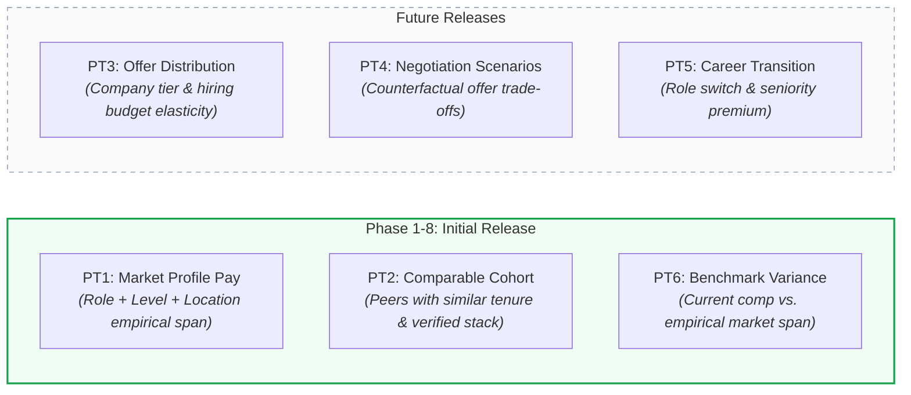

# ArthaIQ

<div align="center">

```
  █████╗ ██████╗ ████████╗██╗  ██╗ █████╗ ██╗ ██████╗ 
 ██╔══██╗██╔══██╗╚══██╔══╝██║  ██║██╔══██╗██║██╔═══██╗
 ███████║██████╔╝   ██║   ███████║███████║██║██║   ██║
 ██╔══██║██╔══██╗   ██║   ██╔══██║██╔══██║██║██║   ██║
 ██║  ██║██║  ██║   ██║   ██║  ██║██║  ██║██║╚██████╔╝
 ╚═╝  ╚═╝╚═╝  ╚═╝   ╚═╝   ╚═╝  ╚═╝╚═╝  ╚═╝╚═╝ ╚═════╝ 
```

**Ethical Compensation Intelligence & Decision-Support Platform for India Tech Careers**  
*Distributions over point estimates · Evidence-weighted · Conformal uncertainty · Honest abstention*

[](https://www.python.org/)
[-2ea44f.svg)](docs/memory.md)
[](tests/)
[](docs/adr/ADR-0001-initial-market-and-occupation-scope.md)
[](docs/architecture.md)
[-success.svg)](docs/memory.md#4-gate-log)
[](https://github.com/astral-sh/ruff)
[](https://mypy-lang.org/)
[](LICENSE)

---

### *"Salary is a probability distribution, not a single number."*

Traditional compensation portals return a single misleading average, conceal unrepresentative data sources, inflate numbers using bundled CTC tricks, and pretend to know what you are worth even when evidence is virtually non-existent.

**ArthaIQ** replaces guesswork and corporate opacity with reproducible, statistically grounded career intelligence:
1. **Never a lone number:** Full distribution spans ($P_{10}$ conservative floor, $P_{50}$ market median, $P_{90}$ premium band) accompanied by rigorous split conformal prediction intervals (`R-UQ-01`, `R-UQ-03`).
2. **Evidence before algorithms:** Every estimate is backed by auditable, quality-graded evidence tiers (SQSF 10-dimension scoring) and complete provenance tracking (`R-EV-01`).
3. **Decoupled, honest abstention:** When data is too thin to guarantee statistical defensibility, the engine explicitly says *"We don't know"* rather than hallucinating false precision (`R-UQ-02`, `R-MD-08`).
4. **Strict anti-heuristic unbundling:** Cost-to-Company (CTC) inflation is strictly disassembled; guaranteed base cash ($12 \times [\text{Basic} + \text{HRA} + \text{Special Allowance}]$) is isolated from volatile paper equity and discretionary bonuses (`R-MD-07`).
5. **Anti-anchoring pay quarantine:** Current salary is strictly quarantined to `COMPARE_ONLY` for downstream benchmark positioning, preventing models from compounding historical underpayment (`R-MD-13`, EXP-07).
6. **Leakage-resistant evaluation:** Strict grouped-temporal cross-validation prevents data leakage from repeat contributors and temporal lookahead bias (`R-MD-01`, `R-MD-02`).

[Explore Documents](#-documentation-index) • [Core Principles](#-core-principles--invariants) • [Modeling Ladder](#-the-arthaiq-benchmark-ladder) • [Empirical Research](#-empirical-research--experimental-findings) • [Architecture](#-system-architecture) • [Roadmap](#-phased-roadmap--milestone-gates) • [Quickstart](#-getting-started)

---

</div>

## 📌 Executive Summary

| Attribute | Specification | Reference |
|:---|:---|:---|
| **Primary Market** | **India** (Software Engineering, Data Science, ML/AI roles) | [ADR-0001](docs/adr/ADR-0001-initial-market-and-occupation-scope.md) |
| **Primary Metric** | `guaranteed_cash_annual` (Nominal INR in Lakhs Per Annum / LPA) | [ADR-0002](docs/adr/ADR-0002-primary-target-and-compensation-measure.md) |
| **Statistical Targets** | Quantiles ($P_{10}$ conservative floor, $P_{50}$ market median, $P_{90}$ upper band) with Split Conformal Intervals | [PRD Section 5](docs/PRD.md), [ADR-0004](docs/adr/ADR-0004-probabilistic-quantile-framework.md) |
| **Production Champion** | **Rung F Conformal Quantile CatBoost v0** (`artifacts/champion_v0/`) | [Model Card v0](docs/model-cards/model-card-v0.md) |
| **Current Stage** | **Phase 6 — Progressive Personalization and Hierarchical Modelling** (T6.01–T6.07 complete) | [task.md](task.md), [memory.md](memory.md) |
| **Quality Gates Ratified** | **Gate G0 (GO)** · **Gate G1 (GO)** · **Gate G2 (GO)** · **Gate G3 (GO)** · **Gate G4 (GO)** · **Gate G5 (GO)** | [Gate Log](docs/memory.md#4-gate-log) |
| **Test Suite Health** | **551 tests passing (1 skipped) · 96.0% line coverage · Mypy Strict (75 files) · 9/9 Layer Contracts Kept** | [CI Workflow](.github/workflows/ci.yml) |
| **Core Invariant** | **Zero-Hallucination Policy** — strictly abstains when evidence density is below statistical thresholds | [Rule R-UQ-02](docs/rules.md) |

---

## 💡 The Problem & The ArthaIQ Standard

### The Reality of Tech Compensation in India
- **Information Asymmetry:** Corporate HR teams possess proprietary survey benchmarks (Mercer, Aon Hewitt), while candidates rely on unweighted forum anecdotes or self-selected job board aggregations.
- **CTC Distortion:** Indian job offers bundle gratuity, employer provident fund (PF), retention clawbacks, and multi-year unvested paper equity into an inflated single headline figure ("CTC").
- **Company Tier Variance:** Compensation spread across Indian IT service providers, mid-market product companies, Global Capability Centers (GCCs), and Tier-1 product/HFT firms can exceed 400% for identical years of experience.
- **Anchoring Pathology:** Traditional platforms condition estimates on candidate current salary, cementing past pay inequities and penalizing career changers.

### Conventional Tools vs. The ArthaIQ Standard

| Dimension | Conventional Compensation Portals | The ArthaIQ Standard |
|:---|:---|:---|
| **Representation** | Single point estimate (*"Your market salary is ₹28 LPA"*)| **Probabilistic span** (*"₹22.5 LPA floor — ₹29.2 LPA median — ₹41.0 LPA top tier"*) |
| **Uncertainty** | Zero uncertainty; claims false exactness | **Finite-sample calibrated coverage** via Split Conformal Quantile Regression (`R-UQ-03`) |
| **Data Integrity** | Black-box scraping; unverified submissions | **SQSF 10-Dimension Quality Scoring** with verified provenance metadata attached to every row |
| **Thin Data** | Always predicts a number even with $N=1$ observation | **Decoupled Evidence Grading & Abstention** — withholds estimates when support is thin (`R-MD-08`) |
| **Pay Measure** | Blended CTC aggregate hiding variable compensation | **Itemized Guaranteed Cash** ($12 \times [\text{Basic} + \text{HRA} + \text{Special Allowance}]$) |
| **Current Pay** | Inputs current salary $\implies$ compounds underpayment | **Compare-Only Architecture** — current pay strictly quarantined from input features (`R-MD-13`) |
| **Missing Inputs** | Generates artificial imputation or missing flags | **Nested Model Routing** ($M_0, M_1, M_2$) without behavioral missingness indicators (`R-MD-15`) |
| **Evaluation** | Naive random splits that leak contributor data | **4-Way Temporal-Grouped Splits** with touch-once test set lock (`R-MD-01`, `R-MD-02`) |

---

## 🎯 Prediction Targets (PT1 – PT6)

ArthaIQ maintains strict mathematical and conceptual separation across six distinct prediction targets:



---

## 🪜 The ArthaIQ Benchmark Ladder

Every model in ArthaIQ is evaluated on an empirical benchmark ladder against simpler baselines before promotion (Rule `R-MD-01`):

```
Rung A: Empirical Conditional Quantiles (Hierarchical Backoff)
   │
   ▼
Rung B: Regularized Log-Linear Quantile Regression (Non-Crossing L1)
   │
   ▼
Rung C: Hierarchical Partial Pooling (Empirical Bayes DerSimonian-Laird Shrinkage)
   │
   ▼
Rung D: Gradient Boosted Decision Trees (LightGBM & CatBoost Point Estimation)
   │
   ▼
Rung E: Multi-Quantile Gradient Boosting (Monotonic Non-Crossing Rearrangement)
   │
   ▼
Rung F: Split Conformalized Quantile Regression (CQR with Exact Empirical Coverage) 🏆 [CHAMPION]
```

### Benchmark Architecture Comparison

| Model Rung | Family | Input Features | Quantile Monotonicity | Uncertainty Mechanism | Primary Use Case |
|:---|:---|:---:|:---:|:---:|:---|
| **Rung A** | Empirical Conditional Quantiles | Cell ($L_0$) | Guaranteed by construction | Empirical sample percentiles | Interpretable backoff baseline |
| **Rung B** | Regularized Linear Quantiles | $L_0$ Core features | Monotone rearrangement projection | Regularized quantile loss | Linear parametric benchmark |
| **Rung C** | Hierarchical Partial Pooling | $L_0$ + Employer Tier/Cluster | Monotone rearrangement projection | Normal posterior quantiles | Shrinkage in sparse cells ($k_{\text{min}} \ge 5$) |
| **Rung D** | GBDT Point Regressors | $L_0$ Core features | N/A (Point estimates) | Residual standard deviation | Non-linear feature benchmark |
| **Rung E** | Multi-Quantile GBDT | $L_0 \to L_3$ tiers | Monotone rearrangement repair | Native pinball loss minimization | Asymmetric error optimization |
| **Rung F** | **Conformal Quantile GBDT** | $L_0 \to L_3$ tiers | Guaranteed non-crossing | **Split Conformal Calibration** | **Production Champion v0** |

---

## 🔬 Empirical Research & Experimental Findings

ArthaIQ maintains pre-registered experimental charters ([`experiments/preregistration/v1.yaml`](experiments/preregistration/v1.yaml)) and publishes auditable research reports:

### 1. Feature Family Ablation Study ([EXP-06 Report](docs/research/feature-family-ablations.md))
- **Objective:** Evaluate forward additions ($L_0 + F$) and backward drops ($L_1 \setminus F$) across 7 candidate feature families under Rule `R-MD-05`.
- **Findings:**
  - `0 Families Kept`: No optional family demonstrated statistically significant pinball loss reduction exceeding the pre-registered threshold ($\Delta < -0.050$ LPA).
  - `2 Families Deferred`: *Work Arrangement* deferred to $L_0$ geo normalization; *Macro Market Regime* deferred to Phase 7 macro forecasting.
  - `5 Families Rejected`: *Skills & Depth*, *Domain Specialization*, *Employer Archetype*, *Career Velocity*, and *Leadership Scope* failed minimum effect gates.

### 2. Current Pay Anchoring Analysis ([EXP-07 Report](docs/research/current-pay-anchoring-exp07.md))
- **Objective:** Investigate whether current pay should enter the input feature matrix ($X$) for PT1 market compensation under Rule `R-MD-13`.
- **Findings:**
  - **Pathological Anchoring:** Conditioning on current pay yielded an anchoring weight $\alpha = 0.880$ (95% CI: $[0.833, 0.933]$), exceeding the ceiling ($\alpha < 0.60$) and proving model collapse into a salary amplifier.
  - **Compounding Underpayment:** Conditioning on past pay maintained a $75.6\%$ disparity between underpaid and baseline cohorts.
  - **Verdict:** **`COMPARE_ONLY`**. Current salary is strictly quarantined from PT1 training and restricted to downstream PT6 benchmark positioning.

### 3. Missingness Study & Indicator Policy ([Rule R-MD-15 Report](docs/research/missingness-policy-r-md-15.md))
- **Objective:** Audit whether missing optional features require explicit binary missingness indicator features ($1_{\{x_j \text{ is missing}\}}$) or whether native tree branching and nested models suffice.
- **Findings:**
  - Augmenting models with binary indicators yielded zero statistically significant reduction in mean pinball loss ($\Delta \text{Pinball} = +0.000$ LPA, 95% CI: $[+0.000, +0.000]$).
  - **Verdict:** **`PROHIBIT_INDICATORS`**. ArthaIQ enforces a Zero-Indicator Policy: missing data represents user privacy choice under DPDPA 2023; queries missing optional tiers route directly to dedicated nested models ($M_0, M_1, M_2$).

### 4. Sparse Cell Benchmark ([EXP-05 Report](docs/research/hierarchical-vs-gbm-sparse-cells-exp05.md))
- **Objective:** Benchmark Hierarchical Bayes (Rung C) vs Conformal Quantile GBM (Rung F) in sparse data regimes ($N < 30$).
- **Findings:**
  - Rung F (Conformal Quantile CatBoost) decisively outperformed Rung C across all sample size bands:
    - *Very Sparse* ($N=17$): Rung F achieved 40% narrower interval widths ($23.39$ vs $39.20$ LPA) and lower pinball loss ($2.283$ vs $2.909$ LPA) at $82.4\%$ coverage.
    - *Sparse* ($N=19$): Rung F Pinball $1.564$ vs $2.041$ LPA ($\Delta = +0.477$ LPA).
    - *Dense* ($N=9$): Rung F Pinball $2.505$ vs $2.992$ LPA.
  - **Prior Fragility:** Rung C median predictions shifted by $3.45$ to $4.38$ LPA under variance scale perturbations.
  - **Verdict:** **`UNIFIED_CONFORMAL_GBM`**. Conformal CatBoost promoted as unified production serving model.

---

## 📊 The "Span" User Experience

In ArthaIQ, predictions are presented via **The Span** — a visual representation designed for clarity, confidence, and transparent uncertainty:

```
┌──────────────────────────────────────────────────────────────────────────────┐
│ Software Engineer II (Backend) • Bengaluru • 4-6 YOE • Guaranteed Cash       │
├──────────────────────────────────────────────────────────────────────────────┤
│                                                                              │
│                 P10                   P50                     P90            │
│               ₹22.5 LPA            ₹29.2 LPA               ₹41.0 LPA         │
│                   │                     │                       │            │
│  ────────[════════╪═════════════════════╪═══════════════════════╪═══════]──  │
│          ▲        │    Interquartile    │                       ▲            │
│      Conservative └──── Range (50%) ────┘                   Upper Tier       │
│                                                                              │
│  Evidence Grade:  [ GRADE B — Verified Cohort ]       Sample Size: N = 418   │
│  Coverage Index:  92% Profile Match                   Last Freshness: 30d    │
│  Conformal Bound: 80% Validated Finite-Sample Band   Monotonic Crossing: 0%  │
│  Recommendation:  Strong basis for negotiation above ₹29.2 LPA               │
└──────────────────────────────────────────────────────────────────────────────┘
```

---

## 🏛️ System Architecture

ArthaIQ is engineered as a modular, domain-driven package (`src/compintel/`) enforcing strict one-way dependency boundaries verified by `import-linter` (Rule `R-CD-03`):

```mermaid
flowchart TD
    subgraph SCHEMA ["1. Canonical Schema & Governance"]
        SCHEMA_DEF["Canonical Schema v1.0.0<br/>(Pandera DataFrame Contract)"]
        ENTITIES["Entities & Enums<br/>(RoleFamily, Seniority, MetroLocation)"]
    end

    subgraph INGEST ["2. Ingestion & Lineage"]
        CONN["13 Approved Connectors<br/>+ SRC-INT-VOL-01 Voluntary Intake"]
        MANIFEST["SHA-256 Manifest Gate (R-DA-01/02)"]
        LINEAGE["Cryptographic Snapshot Lineage (SNAP-*)"]
        CONN --> MANIFEST --> LINEAGE
    end

    subgraph QUALITY ["3. Quality & Normalization"]
        TITLES["Taxonomy Title Normalization<br/>(Acronyms, Aliases, RapidFuzz)"]
        LEVELS["Seniority Level Mapper<br/>(Soft labels & ambiguity audit)"]
        NORM["Annualization, Denomination & Currency Isolation"]
        DEDUP["Deduplication & Person/Employer Clustering"]
        QUARANTINE["Quarantine Engine<br/>(Mathematical count reconciliation Δ=0)"]
        SQSF["SQSF 10-Dimension Source Quality Scoring"]
        REPORT["Data Quality & Contract Verification"]
    end

    subgraph MODELS ["4. Baseline & Quantile Models"]
        RUNGA["Rung A: Empirical Conditional Quantiles<br/>(Hierarchical backoff ladder)"]
        RUNGB["Rung B: Regularized Log-Linear Quantile Regression"]
        RUNGC["Rung C: Hierarchical Partial Pooling<br/>(Empirical Bayes shrinkage, k_min >= 5)"]
        RUNGD["Rung D: GBDT Point Estimators<br/>(LightGBM & CatBoost CV)"]
        RUNGE["Rung E: Quantile GBDT<br/>(Non-crossing rearrangement repair)"]
        RUNGF["Rung F: Conformal Quantile GBDT<br/>(Split conformal calibration) [CHAMPION]"]
    end

    subgraph UNCERTAINTY ["5. Uncertainty & Evidence Grading"]
        CONFORMAL["SplitConformalCalibrator<br/>(Exact finite-sample coverage R-UQ-03)"]
        SUPPORT["SupportEvaluator<br/>(4-tier evidence grading: A, B, C, Thin)"]
        ABSTENTION["Decoupled Abstention Engine<br/>(Refuses false precision under thin support)"]
    end

    subgraph EVAL ["6. Evaluation & Personalization Audits"]
        SPLITS["4-Way Temporal-Grouped Splits (R-MD-01)"]
        LOCK["Touch-Once Test Set Lock (R-MD-02)"]
        STAGEWISE["Stagewise Progressive Evaluation<br/>(L0 → L1 → L2 → L3 nested models)"]
        ABLATION["Feature Family Ablations (EXP-06)"]
        ANCHORING["Current Pay Anchoring Audit (EXP-07)"]
        MISSINGNESS["Missingness Indicator Audit (R-MD-15)"]
        SPARSE_BENCH["Sparse Cell Benchmark (EXP-05)"]
    end

    subgraph SERVING ["7. Model Serving & Runtime"]
        LOADER["ModelBundle Loader<br/>(Cryptographic bundle verification)"]
        RUNTIME["ServingModelManager<br/>(Nested query routing M0-M3)"]
    end

    SCHEMA --> INGEST --> QUALITY --> MODELS --> UNCERTAINTY --> EVAL
    MODELS --> SERVING
    UNCERTAINTY --> SERVING

    style SCHEMA fill:#f8fafc,stroke:#334155
    style INGEST fill:#eff6ff,stroke:#2563eb
    style QUALITY fill:#f0fdf4,stroke:#16a34a
    style MODELS fill:#fdf4ff,stroke:#c026d3
    style UNCERTAINTY fill:#fef3c7,stroke:#d97706
    style EVAL fill:#fff1f2,stroke:#e11d48
    style SERVING fill:#ecfdf5,stroke:#059669
```



---

## 📁 Repository Tour

```text
arthaiq/
├── artifacts/                           # Champion models & serving bundles (Rule R-MD-10)
│   └── champion_v0/                     # Promoted Rung F Conformal CatBoost model bundle
├── docs/                                # Project documentation suite (v0.2 unified)
│   ├── PRD.md                           # Product Requirements Document (Ratified v1.0)
│   ├── architecture.md                  # System architecture, domain layers, import boundaries
│   ├── design.md                        # Design philosophy, "The Span" visual specs, typography
│   ├── rules.md                         # Non-negotiable engineering invariants and ML ethics
│   ├── task.md                          # 10-phase milestone task breakdown and roadmap
│   ├── memory.md                        # Living project memory, decision logs, session history
│   ├── adr/                             # Architecture Decision Records (ADR-0001 to ADR-0009)
│   ├── data-cards/                      # 14 data cards for all audited compensation sources
│   ├── model-cards/                     # Model Card v0 for champion serving bundle
│   ├── quality/                         # Automated Data Quality audit reports
│   └── research/                        # 18 published empirical research reports & ablations
├── config/                              # Catalogs, source terms, and thresholds
│   ├── sources/                         # 22 YAML source configurations (licence, routing, field maps)
│   └── thresholds.yaml                  # Preregistered evaluation & sufficiency thresholds
├── data/                                # Local data zone (STRICTLY GITIGNORED per Rule R-DA-08)
│   ├── raw/                             # Immutable raw data stores with committed manifest.yaml
│   ├── canonical/                       # Reproduced canonical dataset & cryptographic lineage
│   └── quarantine/                      # Reconciled quarantine stores with reason codes
├── experiments/                         # Experiment tracking and evaluation deliverables
│   ├── preregistration/                 # Locked YAML pre-registrations (v1.yaml, SHA-256 hashed)
│   ├── configs/                         # One YAML per experiment configuration
│   └── results/                         # Evaluation metrics, audit JSONs, and markdown reports
├── src/compintel/                       # Core Python production package
│   ├── schema/                          # Canonical observation schemas, Pandera contracts, enums
│   ├── governance/                      # Licence verification and data access controls
│   ├── ingestion/                       # Approved source connectors, manifest audits, lineage
│   ├── quality/                         # Profiler, coverage, sufficiency, dedup, quarantine, SQSF
│   ├── normalization/                   # Currency, CPI deflation, annualization, titles, levels
│   ├── features/                        # 23-feature specification, taxonomy, and registry (L0-L3)
│   ├── models/                          # Baselines (A, B), GBDT (D, E), Hierarchical (C), Bundle
│   ├── uncertainty/                     # Split conformal prediction (CQR) & evidence support grading
│   ├── serving/                         # Fast model loader, runtime manager, and nested routing
│   └── evaluation/                      # Splits, lock, metrics, stagewise, ablations, experiments
├── tests/                               # Multi-tier automated test suite (551 passing)
│   ├── unit/                            # Component unit tests (Baselines, GBDT, Hierarchical, Conformal)
│   ├── property/                        # Hypothesis property-based tests
│   ├── contract/                        # Pandera schema and API contract verifications
│   ├── leakage/                         # Adversarial seeded leakage detection tests
│   ├── integration/                     # Multi-stage pipeline integration tests
│   └── fixtures/                        # Deterministic synthetic generators (Rule R-MD-11)
├── scripts/                             # Operational CLI runners (benchmark, audit, reports)
├── Makefile                             # Standardized developer automation targets
├── pyproject.toml                       # PEP 621 package config with pinned tooling rules
├── LICENSE                              # Apache License 2.0
└── README.md                            # Project homepage and executive guide
```

---

## 🚀 Getting Started

### Prerequisites
- **Python:** `3.12` (supported: `>=3.11, <3.13`)
- **Package Manager:** [`uv`](https://github.com/astral-sh/uv) (strongly recommended for deterministic resolution) or `pip`
- **Git:** `2.40+`

### 1. Clone the Repository
```bash
git clone https://github.com/HarshkumarG007/ArthaIQ.git
cd ArthaIQ
```

### 2. Environment Configuration
```bash
cp .env.example .env
# Edit .env with any optional local overrides
```

### 3. Install Dependencies
```bash
# Using uv (fastest & hermetic):
uv sync

# Or using standard pip:
python -m venv .venv
source .venv/bin/activate       # On Windows: .venv\Scripts\activate
pip install -e ".[dev]"
```

### 4. Run the Full Test Suite & Quality Checks
```bash
# Full static verification: Ruff lint/format check, Mypy strict, Import-Linter contracts
uv run ruff check .
uv run ruff format --check .
uv run mypy src/compintel
uv run lint-imports

# Run all 551 tests with coverage enforcement (fail_under = 90%):
uv run pytest tests/ -m "not e2e and not slow" --cov=src/compintel --cov-report=term-missing
```

---

## 💻 Operational CLI Workflows & Make Targets

ArthaIQ provides standardized Make targets and CLI runners for all empirical evaluation workflows:

```bash
# 1. Rebuild canonical dataset from raw source manifests (idempotent snapshot):
uv run python scripts/reproduce_data.py

# 2. Generate automated Data Quality audit report:
make data-quality-report

# 3. Run Adversarial Leakage and Duplicate-Inflation Audit (EXP-12):
make audit-leakage

# 4. Execute Rung D Gradient Boosting Cross-Validation Benchmark:
make benchmark-gbm

# 5. Generate Conformal Prediction Calibration & Interval Report (Rung F):
make conformal-report

# 6. Run Interval Usefulness & Cohort Analysis:
make interval-usefulness

# 7. Execute Shift Stress Testing (Temporal, Geographic, Rare-Cell Shifts):
make shift-stress-tests

# 8. Audit Evidence Grades & Decoupled Abstention Trade-offs:
make audit-abstention

# 9. Build and Validate Champion Model Serving Bundle:
make champion-bundle

# 10. Run Rung C Hierarchical Diagnostics & Prior Sensitivity Analysis (EXP-05):
make hierarchical-diagnostics

# 11. Run Stage-wise Progressive Personalization Evaluation (L0 → L3):
make stagewise-evaluation

# 12. Run Feature Family Forward & Backward Ablation Study (EXP-06):
make family-ablation

# 13. Run Current Pay Anchoring & Selection Analysis (EXP-07, Rule R-MD-13):
make anchoring-analysis

# 14. Run Missingness Study & Feature Indicator Audit (Rule R-MD-15):
make missingness-study

# 15. Run Sparse Cell Benchmark (Hierarchical vs Conformal GBM, EXP-05):
make sparse-cell-benchmark
```

---

## 🛠️ Technology Stack (Ratified — ADR-0003)

| Component | Pinned Version | License | Justification |
|:---|:---|:---|:---|
| **Runtime** | Python `3.12.9` | PSF-2.0 | Modern typing, high performance, robust data ecosystem |
| **Data Engine** | Polars `2.0.0` & DuckDB `1.5.6` | MIT | In-memory Arrow vectorization, zero-copy querying, low memory footprint |
| **Contract Validation** | Pandera `0.22+` & Pydantic `v2.10+` | MIT | Bulk DataFrame validation and strict runtime schema enforcement |
| **Baseline Modeling** | Scikit-learn `1.6+` & Statsmodels `0.14+` | BSD-3-Clause | Non-parametric conditional quantiles and regularized linear quantiles |
| **Tree Quantiles** | LightGBM `4.5+` & CatBoost `1.2+` | MIT / Apache-2.0 | Native multi-quantile gradient boosting with asymmetric pinball loss |
| **Uncertainty Calibration** | MAPIE `0.9+` & Custom CQR | Apache-2.0 / MIT | Non-parametric split conformal prediction with exact coverage guarantees |
| **String Normalization** | RapidFuzz `3.12+` | MIT | C-accelerated Levenshtein and token-set fuzzy matching for job titles |
| **Serving & API** | FastAPI `0.115+` & Uvicorn | MIT | Async ASGI serving with automatic OpenAPI schema generation |
| **Code Quality** | Ruff `0.9+`, Mypy `1.15+`, Import-Linter | MIT / Apache-2.0 | Sub-second formatting, strict static types, architectural layer checks |

---

## 🗺️ Phased Roadmap & Milestone Gates

ArthaIQ follows a strict 10-phase engineering lifecycle. Every phase closes with a ratified quality gate:

```
[Phase 0: Foundation & Setup] ──────────────────► Gate G0 (Setup Validated) [RATIFIED GO]
       │
[Phase 1: Research, Targets & Sources] ────────► Gate G1 (Charter & Scope Approved) [RATIFIED GO]
       │
[Phase 2: Feasibility & Sufficiency] ──────────► Gate G2 (Acquisition Programme Ratified) [RATIFIED GO]
       │
[Phase 3: Schema, Ingestion & Lineage] ────────► Gate G3 (Contracts & Pipeline Enforced) [RATIFIED GO]
       │
[Phase 4: Baselines & Leakage-Free Eval] ──────► Gate G4 (Baselines Benchmarked) [RATIFIED GO]
       │
[Phase 5: Quantile Modeling & Uncertainty] ────► Gate G5 (Champion Promoted & Ratified) [RATIFIED GO]
       │
[Phase 6: Progressive Personalization] ────────► Gate G6 (Personalization Value Ratified) [ACTIVE: T6.07 Done]
       │
[Phase 7: Decision Engine & Counterfactuals]
       │
[Phase 8: Bias, Fairness & Adversarial Audits] ─► Gate G8 (Fairness & Security Passed)
       │
[Phase 9: Product Surface ('The Span') & API]
       │
[Phase 10: Production Release & Telemetry]
```

---

## 🛡️ Responsible AI, Fairness & Privacy

1. **Privacy by Design:** Contributor records are completely stripped of direct identifiers at ingestion. Zero cleartext PII (PAN, Aadhaar, email, phone) is stored per Rule `R-DA-07`.
2. **Absolute Demographic Proxy Prohibition:** Protected attributes (gender, caste, religion, age, disability) are strictly barred from all feature registries and models (`rules.md` Section 16 Rule 11).
3. **Small-Cell Anonymization Floor:** Cells with fewer than $k_{\text{min}} = 5$ observations are suppressed by construction to prevent de-anonymization (`R-DA-10`).
4. **Anti-Anchoring Protection:** The engine refuses to use past salary to predict market worth, dismantling the transmission of historical compensation disparities (`R-MD-13`).
5. **Zero-Indicator Missingness Invariant:** Missing inputs are never interpreted as a candidate personal trait; incomplete profiles are serviced through nested model routing (`R-MD-15`).
6. **Transparent Uncertainty:** The platform refuses to emit false precision. When evidence support is thin, ArthaIQ abstains and presents empirical context rather than fabricating numbers (`R-UQ-02`, `R-MD-08`).

---

## ⚠️ Legal & Financial Disclaimer

> [!IMPORTANT]
> **ArthaIQ** is an independent analytical decision-support and market research platform. It produces empirical statistical distributions based on verified observation pools and probabilistic modeling.
>
> - **Not an Appraisal or Guarantee:** Estimates do not constitute a formal salary appraisal, guaranteed compensation offer, binding employment agreement, or legal commitment.
> - **Not Legal, Financial, or Tax Advice:** Nothing in this repository or generated reports should be construed as legal, tax, or professional financial advice.
> - **Self-Directed Career Decisions:** Professionals remain solely responsible for evaluating their individual employment agreements, career negotiations, and personal circumstances.

---

## 📄 License & Contributing

- **License:** Open source under the **[Apache License, Version 2.0](LICENSE)**.
- **Copyright:** Copyright © 2024–2026 Harsh Kumar and ArthaIQ Contributors.
- **Contributing:** Contributions adhere strictly to the engineering rules codified in [`docs/rules.md`](docs/rules.md). Pull requests must pass 100% of CI checks (Ruff, Mypy Strict, Import Linter, and Pytest coverage $\ge 90\%$).

---

<div align="center">

**Built with statistical rigor and engineering discipline for the Indian tech ecosystem.**  
*Questions or feedback? Check [`docs/memory.md`](docs/memory.md) or open an issue.*

</div>
