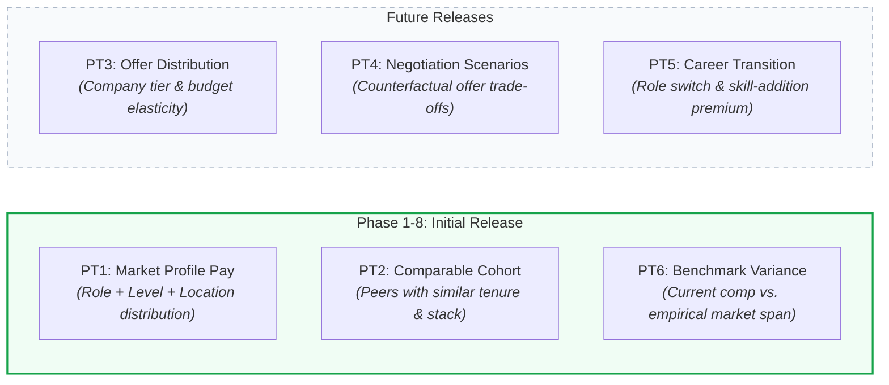
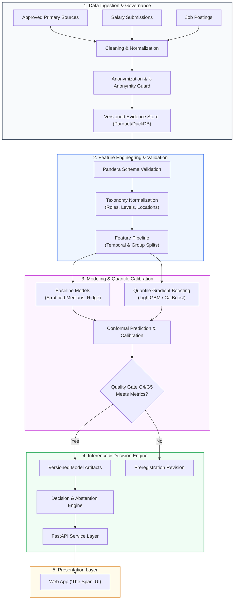

# ArthaIQ

<div align="center">

```
  █████╗ ██████╗ ████████╗██╗  ██╗ █████╗ ██╗ ██████╗
 ██╔══██╗██╔══██╗╚══██╔══╝██║  ██║██╔══██╗██║██╔═══██╗
 ███████║██████╔╝   ██║   ███████║███████║██║██║   ██║
 ██╔══██║██╔══██╗   ██║   ██╔══██║██╔══██║██║██║   ██║
 ██║  ██║██║  ██║   ██║   ██║  ██║██║  ██║██║╚██████╔╝
 ╚═╝  ╚═╝╚═╝  ╚═╝   ╚═╝   ╚═╝  ╚═╝╚═╝  ╚═╝╚═╝ ╚═════╝
```

**Personalized Compensation Intelligence & Decision-Support System**
*Distributions over point estimates · Evidence-weighted · Honest abstention*

[](https://www.python.org/)
[](docs/memory.md)
[](docs/adr/ADR-0001-initial-market-and-occupation-scope.md)
[](docs/architecture.md)
[](https://github.com/astral-sh/ruff)
[](https://mypy-lang.org/)
[](docs/memory.md#licence)

---

### *"Salary is a probability distribution, not a single number."*

Traditional compensation calculators return a single misleading average, obscure their data sources, and pretend to know what you are worth even when they have no evidence.

**ArthaIQ** replaces guesswork with rigorous statistical decision support:
1. **Never a lone number:** Full distribution spans ($P_{10}$, $P_{50}$, $P_{90}$) with interquartile confidence bands.
2. **Evidence before algorithms:** Every estimate is backed by auditable, quality-graded evidence tiers (Grades A–E).
3. **Honest abstention:** When data is too thin to guarantee statistical validity, it explicitly says *"We don't know"* rather than hallucinating a false estimate.
4. **Counterfactual decision support:** Evaluates offer trade-offs, company tier differentials (GCC vs Product vs Service vs High-Frequency Trading), and location arbitrage.

[Explore Documents](#-documentation-index) • [Core Philosophy](#-core-principles) • [Architecture](#-system-architecture) • [Roadmap](#-phased-roadmap--quality-gates) • [Quickstart](#-getting-started)

---

</div>

## 📌 Executive Summary

| Attribute | Specification |
|:---|:---|
| **Primary Market** | **India** (Initial focus: Software Engineering, Data Science, ML/AI roles) |
| **Primary Metric** | `guaranteed_cash_annual` (Nominal INR in Lakhs Per Annum / LPA) |
| **Statistical Target** | Quantiles ($P_{10}$ conservative floor, $P_{50}$ market median, $P_{90}$ premium band) |
| **Target Audience** | Tech professionals evaluating offers, benchmarking compensation, or planning transitions |
| **Current Stage** | **Phase 0 — Foundation & Repository Setup** (Task `T0.02`) |
| **Core Invariant** | **Zero-Hallucination Policy** — strictly abstains when evidence density is below statistical thresholds |

---

## 💡 The Problem & The ArthaIQ Solution

### The Reality of Tech Compensation in India
- **Asymmetric Information:** Employers leverage proprietary survey vendors (Mercer, Aon Hewitt), while employees rely on unverified forum anecdotes or unweighted crowd-sourced aggregates.
- **Structural Distortion:** In India, total CTC (Cost to Company) frequently bundles variable pay, gratuity, employer PF contributions, joining retention clawbacks, and paper equity into an inflated single figure.
- **Company Tier Variance:** The compensation spread between Indian IT services, mid-tier product firms, Global Capability Centers (GCCs), and Tier-1 product/algorithmic trading firms can exceed 400% for identical years of experience.

### Why Standard Tools Fail vs. How ArthaIQ Solves It

| Conventional Tools | The ArthaIQ Standard |
|:---|:---|
| **Single point estimate** (*"Your market salary is ₹28 LPA"*) | **Probabilistic distribution span** (*"₹22.5 LPA floor — ₹27.8 LPA median — ₹36.2 LPA top tier"*). |
| **Black-box opacity** (No clue where figures come from) | **Explicit evidence grades (A–E)** with sample counts and data freshness timestamps. |
| **Always produces a number** even with 1 observation | **Hard abstention rule** — refuses to predict when statistical support is insufficient. |
| **Static averages** blind to structural compensation components | **Disaggregated view** separating guaranteed base cash from performance variable and equity. |
| **Zero decision assistance** | **Counterfactual "What-If" modeling** for offer evaluations, relocations, and career level steps. |

---

## 🎯 Prediction Targets (PT1 – PT6)

ArthaIQ maintains strict conceptual and statistical separation across six distinct prediction targets:



---

## ⚖️ Core Principles & Invariants

Every line of code and statistical procedure adheres to the strict rules codified in [`docs/rules.md`](docs/rules.md):

1. **No Skipping Steps (R-WF-01):** We follow the phased pipeline strictly: `IDEA → RESEARCH → SPEC → TEST DESIGN → CODE → GATED EVALUATION`.
2. **Evidence Before Algorithms (R-EV-01):** Rigorous data cleaning, validation schemas, and provenance tracking precede any ML model training.
3. **Distributions, Never Lone Numbers (R-UQ-01):** Every estimate must state $P_{10}$, $P_{50}$, $P_{90}$, uncertainty bounds, and limitations.
4. **Honest Abstention (R-UQ-02):** The system must gracefully say *"Insufficient evidence to provide a defensible estimate"* whenever sample density, coverage, or confidence fall below pre-registered thresholds.
5. **No Hard-Coded Multipliers (R-MD-07):** Location, role, and tier adjustments must be empirically learned from data, never populated with arbitrary rule-of-thumb percentages.
6. **Strict Leakage Prevention (R-MD-01):** Temporal and group-aware train/validation/test splits. The final holdout test set is evaluated exactly once at release gate G5.

---

## 📊 The "Span" User Experience

In ArthaIQ, predictions are presented via **The Span** — a visual representation designed for clarity and confidence:

```
┌──────────────────────────────────────────────────────────────────────────────┐
│ Software Engineer II (Backend) • Bengaluru • 4-6 YOE • Guaranteed Cash       │
├──────────────────────────────────────────────────────────────────────────────┤
│                                                                              │
│                 P10                   P50                     P90            │
│               ₹22.5 LPA            ₹29.2 LPA               ₹41.0 LPA         │
│                   │                     │                       │            │
│  ────────[════════╪═════════════════════╪═══════════════════════╪═══════]──  │
│          ▲        │    Interquartile    │                       ▲            │
│      Conservative └──── Range (50%) ────┘                   Upper Tier       │
│                                                                              │
│  Evidence Grade:  [ GRADE B — Verified Cohort ]       Sample Size: N = 418   │
│  Coverage Index:  92% Profile Match                   Last Freshness: 30d    │
│  Recommendation:  Strong basis for negotiation above ₹29.2 LPA               │
└──────────────────────────────────────────────────────────────────────────────┘
```

### Evidence Quality & Prediction Support Framework

> **Methodological Invariant:** A sample-size threshold cannot, by itself, justify an evidence grade or a statistically valid estimate. Representativeness, deduplication, source dependence, temporal recency, and target consistency matter just as much as sample volume.

ArthaIQ decouples **Source Quality** from **Prediction Support** across two independent dimensions:

```
┌─────────────────────────────────────────────────────────────────────────────────────────┐
│                                 EVIDENCE MATRIX                                         │
│                                                                                         │
│  [Source Quality Tier]                [Prediction Support & Reliability]               │
│  • Tier 1: Audited payroll, statutory  • High Support: Multi-source corroborated,       │
│    disclosures, verified filings        deduplicated, fresh (<90d), representative cell  │
│  • Tier 2: Multi-source job postings  • Moderate Support: Limited sources or moderate   │
│    with mandatory salary transparency   dispersion; wider prediction intervals          │
│  • Tier 3: Self-reported contributions• Thin Support: Low effective density or high    │
│    with verification artifacts          clustering; flagged with strict caveats         │
│  • Unacceptable: Scraped forums,      • Abstention: Insufficient support, unaddressed   │
│    unverified anonymous aggregates      bias, or high staleness; PREDICTION WITHHELD    │
└─────────────────────────────────────────────────────────────────────────────────────────┘
```

#### Dual-Dimensional Rating:
1. **Source Quality Grade (Data Provenance & Integrity):**
   - **Grade A (Institutional / Verified):** Statutory filings, verified payroll or institutional compensation disclosures with complete component reconciliation.
   - **Grade B (Triangulated & Normalized):** Multi-source disclosures or structured employer job postings with explicit salary transparency.
   - **Grade C (Verified Self-Reported):** Employee contributions with credential verification and canonical taxonomy mapping.
   - **Grade D (Unverified / Proxy):** Unverified submissions or cross-walked proxy roles; strictly relegated to supplementary signals.

2. **Prediction Support Level (Statistical Soundness in Specific Cell):**
   - **Supported (High Confidence):** Independent sources, low deduplication loss, high cell density, recent observations, and narrow conformal prediction intervals.
   - **Guarded (Moderate Confidence):** Moderate cell density or higher dispersion; wider validated intervals displayed with explicit caveats.
   - **Abstained (Zero-Hallucination Guard):** If data is single-source dependent, heavily stale, unrepresentative, or density is below preregistered sufficiency thresholds, **estimation is withheld**. ArthaIQ presents macro-level context instead of guessing.

---

## 🏛️ System Architecture

ArthaIQ is engineered as a modular, domain-driven system with clean separation of concerns:



---

## 📁 Repository Tour

```
arthaiq/
├── docs/                       # Authoritative documentation repository
│   ├── PRD.md                  # Comprehensive product requirements (v0.1)
│   ├── architecture.md         # System design, data pipelines, and interfaces (v0.1)
│   ├── design.md               # UI design system, components, and interaction patterns (v0.1)
│   ├── rules.md                # Engineering invariants, ML ethics, and AI instructions (v0.1)
│   ├── task.md                 # 10-phase milestone task breakdown (v0.1)
│   ├── memory.md               # Continuous project state, session logs, and decisions (v0.1)
│   ├── adr/                    # Architecture Decision Records (ADR-0001 to ADR-0005)
│   └── research/               # Market, data, and methodology research documents
├── config/                     # Configuration catalogs & schemas
│   ├── sources.yaml            # Registered data sources & licensing terms
│   ├── taxonomy/               # Role, level, and location canonical taxonomies
│   └── thresholds.yaml         # Preregistered error metrics & abstention gates
├── data/                       # Local data directory (gitignored; managed via DVC)
│   ├── raw/                    # Immutable raw ingestion files
│   ├── interim/                # Intermediary cleaned datasets
│   └── processed/              # Verified feature stores
├── experiments/                # Preregistrations, tuning configs, and evaluation logs
├── artifacts/                  # Frozen model packages & metadata manifests (gitignored)
├── notebooks/                  # Pure exploratory research (outputs stripped before commit)
├── src/compintel/              # Production Python package
│   ├── core/                   # Domain entities, value objects, and base protocols
│   ├── evidence/               # Ingestion, validation, and provenance grading
│   ├── features/               # Feature transforms, encoders, and pipelines
│   ├── models/                 # Quantile estimators, conformal calibration, ensembles
│   ├── evaluation/             # Metrics (Pinball loss, coverage, sharpness)
│   └── serving/                # FastAPI application, request schemas, and responses
├── apps/web/                   # Web frontend interface (Next.js/Vite, Phase 9)
├── tests/                      # Multi-tier automated test suite
│   ├── unit/                   # Isolated unit tests
│   ├── property/               # Hypothesis-driven property tests
│   ├── contract/               # Schema and API contract verifications
│   ├── leakage/                # Strict data leakage detection tests
│   ├── integration/            # Component integration tests
│   └── fixtures/               # Test datasets and synthetic golden records
├── infra/                      # Infrastructure, Dockerfiles, and deployment configs
├── scripts/                    # Maintenance, validation, and data verification scripts
├── Makefile                    # Standardized development automation commands
├── pyproject.toml              # Modern PEP 621 package and dependency specification
└── .pre-commit-config.yaml     # Automated linting, formatting, and safety checks
```

---

## 📚 Documentation Index

Every component of ArthaIQ is fully documented. Refer to these canonical references:

| Document | Purpose & Key Topics |
|:---|:---|
| [`docs/PRD.md`](docs/PRD.md) | Product vision, user personas, prediction targets PT1–PT6, user journeys, edge cases, functional specs. |
| [`docs/architecture.md`](docs/architecture.md) | Domain architecture, data schemas, feature engineering, quantile modeling, FastAPI serving layer, data governance. |
| [`docs/design.md`](docs/design.md) | Design philosophy, "The Span" visual specs, typography, responsive breakpoints, accessibility (WCAG AA). |
| [`docs/rules.md`](docs/rules.md) | Strict engineering rules, zero-hallucination policy, anti-leakage guards, testing standards, workflow gates. |
| [`docs/task.md`](docs/task.md) | 100+ task master plan spanning Phases 0 through 10, complete with dependencies and acceptance criteria. |
| [`docs/memory.md`](docs/memory.md) | Living project memory, decision logs (D-001+), open questions (Q-001+), and session-by-session history. |
| [`docs/adr/`](docs/adr/) | Architectural Decision Records documenting critical choices (ADR-0001: India Tech Scope; upcoming ADRs on uncertainty, stack, etc.). |

---

## 🚀 Getting Started

> **Note:** The project is currently in **Phase 1 (Problem Definition & Source Discovery)**. Core runtime dependencies and model training packages will be pinned in Phase 3 under `ADR-0003`. You can immediately set up the repository, pre-commit hooks, and documentation toolchain.

### Prerequisites
- **Python:** `3.11` or higher
- **Package Manager:** `uv` (recommended) or `pip`
- **Git:** `2.40+`
- **Make:** Optional, but recommended for task automation

### 1. Clone the Repository
```bash
git clone https://github.com/HarshkumarG007/ArthaIQ.git
cd ArthaIQ
```

### 2. Configure Environment Variables
```bash
cp .env.example .env
# Edit .env with your local settings
```

### 3. Set Up Virtual Environment & Dependencies
```bash
# Using uv (fastest):
uv venv
source .venv/bin/activate   # On Windows: .venv\Scripts\activate
uv pip install -e ".[dev]"

# Or using standard python venv:
python -m venv .venv
source .venv/bin/activate   # On Windows: .venv\Scripts\activate
pip install -e ".[dev]"
```

### 4. Install Pre-Commit Hooks
```bash
pre-commit install
```

### 5. Run Quality Checks
```bash
# Run all code quality tools
make check

# Or individually:
ruff check .
ruff format --check .
mypy src tests
```

---

## 🛠️ Technology Stack (Proposed — ADR-0003)

| Domain | Technology | Justification |
|:---|:---|:---|
| **Language** | Python 3.11+ | Modern typing support, high-performance runtime, rich data/ML ecosystem |
| **Data Engine** | Polars & DuckDB | Vectorized speed, low memory overhead, Apache Arrow native |
| **Validation** | Pydantic v2 & Pandera | Strict runtime type safety, dataframe schema guarantees |
| **ML & Modeling** | Scikit-learn, LightGBM, CatBoost | Fast native quantile regression, categorical feature handling |
| **Uncertainty** | MAPIE / Conformal Prediction | Mathematically rigorous distribution bounds and empirical coverage |
| **Backend API** | FastAPI & Uvicorn | Async performance, auto-generated OpenAPI docs, Pydantic integration |
| **Web Frontend** | Next.js / React (Phase 9) | Modern component architecture, dynamic interactive charts, responsive UI |
| **Tooling & CI** | Ruff, Mypy, Pytest, GitHub Actions | Sub-second linting, strict static typing, automated gate enforcement |

---

## 🗺️ Phased Roadmap & Quality Gates

The project follows a rigorous 10-phase delivery structure with explicit milestone validation gates:

```
[Phase 0: Foundation] ──► Gate G0 (Setup Validated)
       │
[Phase 1: Research & Discovery] ──► Gate G1 (Taxonomy & Data Approved)
       │
[Phase 2: Data Engineering & Auditing] ──► Gate G2 (Data Sufficiency Verified)
       │
[Phase 3: Core Architecture & Scaffolding] ──► Gate G3 (Contracts Locked)
       │
[Phase 4: Feature Pipeline & Validation]
       │
[Phase 5: Baseline Estimation Engines] ──► Gate G4 (Baseline Benchmarked)
       │
[Phase 6: Quantile Regression & Ensembles]
       │
[Phase 7: Calibration, Uncertainty & Abstention] ──► Gate G5 (Performance Preregistered)
       │
[Phase 8: Decision Engine & API Serving]
       │
[Phase 9: Frontend Experience ('The Span')] ──► Gate G6 (User QA & Security Passed)
       │
[Phase 10: Production Release & Continuous Monitoring]
```

---

## 🛡️ Responsible AI, Fairness & Privacy

1. **Privacy by Design:** All employee records are anonymized at the point of ingestion. Anonymity is guaranteed through $k$-anonymity clustering ($k \ge 5$) before any group statistic is exposed.
2. **Anti-Bias Verification:** Compensation distributions are audited to prevent algorithmic perpetuation of historical wage gaps. Parity metrics are computed across career breaks and background tiers.
3. **No Hallucinated Precision:** The tool rejects false certainty. If a user asks for a rare role with only two data points, ArthaIQ abstains and presents clear guidance on why data is insufficient.
4. **Transparent Methodology:** All model weights, evaluation metrics, and distribution assumptions are accompanied by downloadable methodology cards.

---

## ⚠️ Legal & Financial Disclaimer

> **IMPORTANT NOTICE:**
> **ArthaIQ** is an independent analytical decision-support and market research tool. It provides statistical estimations based on empirical datasets and probabilistic modeling.
>
> - **Not an Appraisal or Offer:** Predictions do not constitute a formal appraisal, guaranteed compensation offer, employment contract, or career commitment.
> - **Not Legal or Tax Advice:** Nothing in this repository or software should be construed as legal, tax, or professional financial advice.
> - **Self-Directed Action:** Users remain solely responsible for evaluating their individual employment agreements, career negotiations, and market circumstances.

---

## 📄 License & Contributing

- **License:** To be formally decided upon resolution of Task `T0.02` (Question `Q-007`). Until resolved, all rights are reserved.
- **Contributing:** Contributions will open after completion of Phase 3 scaffolding. Please review [`docs/rules.md`](docs/rules.md) for architectural guidelines and code quality standards.

---

<div align="center">

**Built with statistical rigor and engineering discipline for the Indian tech ecosystem.**
*Have questions or suggestions? Check [`docs/memory.md`](docs/memory.md) or open an issue.*

</div>
