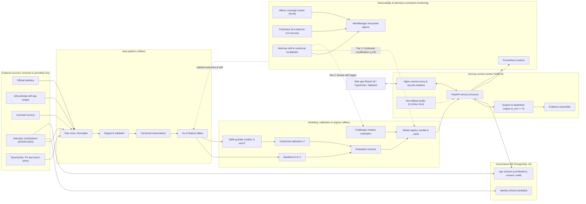
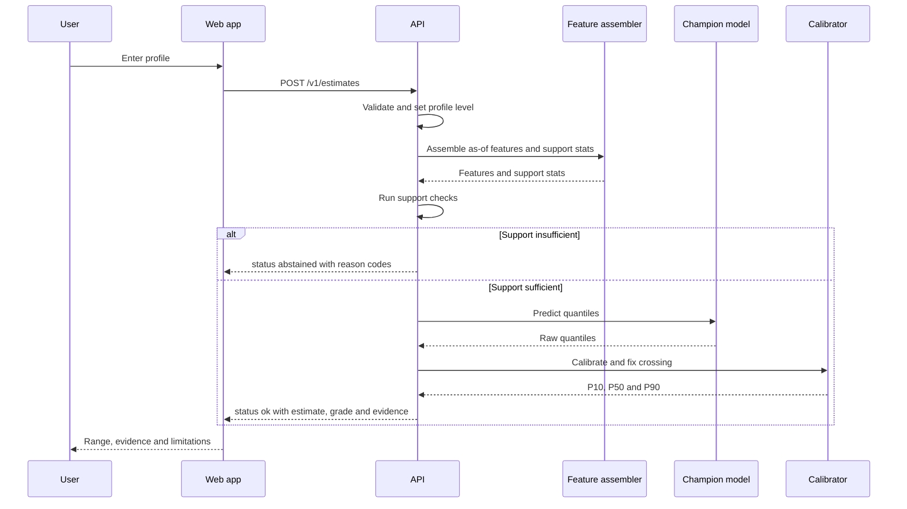

# ArthaIQ System Architecture

| Field | Value |
|---|---|
| Status | v1.0 (Production Verified Architecture; Ratified at Post-Pilot Review T10.07) |
| Last updated | 2026-10-21 |
| Depends on | `PRD.md` v1.1 (requirements FR-xx, NFR-xx, targets PT1 to PT6) |
| Governs | `rules.md` (library policy, layering), `task.md` (Phases 0 to 10) |

Tags: `[H]` hypothesis · `[U]` unverified external fact · `[TBD: id]` decision owed. Versions of tools are deliberately **not** pinned here; they are verified and pinned at T3.01 (R-EV-01).

If a task conflicts with this document, stop and raise it (R-WF-07). Architectural changes need an ADR and a `memory.md` entry.

---

## 1. Purpose and status

This document defines the technical skeleton: the high-level flow, the full technology stack, the folder layout and how the parts talk to each other. It follows the master research prompt's rule that every component must earn its place. Section 5 gives each proposed component an initial disposition (build, experiment, defer, reject) and the condition that would change it.

## 2. Architectural drivers

| Driver | Consequence |
|---|---|
| The data decides the ceiling (RSK-01) | Data work precedes modelling; a sufficiency gate (G2) can stop the project |
| Uncertainty is part of the product | Quantile outputs, calibration, evidence grades and abstention are core, not extras |
| Leakage and duplicates are the likeliest source of fake accuracy | As-of features, grouped-temporal splits, pre-registration, leakage tests |
| Reproducibility is a requirement | Immutable raw data, snapshot ids, seeded runs, one-command reproduction |
| Privacy by design | Minimal fields, identity separated from pay records, k_min on aggregates |
| Limited resources | CPU-only default; simplest model that passes thresholds; no GPU, distributed compute or vector database by default |

## 3. High-level architecture



| Layer | Responsibility | Main outputs | Phase | In research prototype |
|---|---|---|---|---|
| L1 Acquisition and governance | Licensed ingestion, licence register, consent records | Raw zone with manifests | 2, 3 | Yes |
| L2 Quality and evidence scoring | Validation, deduplication, outlier handling, source scores | Staged data, quarantine table, scores | 3 | Yes |
| L3 Representation | Canonical schema, normalization, taxonomy and level mapping, as-of features | Canonical observations, feature tables | 3, 6 | Yes |
| L4a Market baseline | Benchmark ladder, rungs A to F | Quantile predictions | 4, 5 | Yes |
| L4b Personalization | Profile levels L0 to L3, partial pooling | Level-specific predictions | 6 | Yes, conditional on G6 |
| L4c Pay components | Variable pay, equity, first-year versus recurring | Component distributions | 8 | No |
| L4d Scenario engine | Changed-input comparisons with extrapolation guards | Scenario ranges | 8 | No |
| L5 Calibration and validation | Splits, metrics, conformal intervals, abstention, audits | Model bundle, reports | 4 to 6 | Yes |
| L6 Serving and decision support | API, evidence assembly, web app | Responses | 9 | API or CLI only |

## 4. Request flow



Serving reads only model bundles and aggregated reference tables. It never reads raw or record-level data (R-CD-03).

---

## 5. Component audit: initial dispositions

Each row answers the master prompt's questions in short form. Dispositions are priors; the named experiment can overturn them. Full audit text is produced in T1.11.

| Component | Problem it solves | Simplest credible alternative | Initial disposition | Keep if | Reject if |
|---|---|---|---|---|---|
| Four-stage pipeline (ingest, features, hybrid model, inference) | Organizing the work | Three layers (data, model, serve) with one model | **Build** as modular layers. Staged modelling is an **experiment** (error propagation) | Staged beats joint (T6.08) | Errors compound and calibration worsens |
| Quantile GBM (LightGBM, CatBoost) | Non-linear conditional quantiles | Baselines A and B | **Build** as rungs D and E, competing, not predetermined | Beats B and C on pinball loss with CI excluding zero | Parity or worse, especially in sparse cells |
| Ordinal job-level classifier | Standardized level feature | Rule-based mapping with a confidence score, plus raw title tokens | **Experiment** | Soft levels improve error or coverage over hard levels | Label noise dominates |
| Sentence-transformer skill embeddings | Skill similarity | Curated skill taxonomy and TF-IDF | **Defer** to Phase 7 | Measured incremental gain, CPU-feasible | No gain, or similarity mistaken for proficiency |
| Employer graphs, PageRank, Node2Vec, GNN | Employer-prestige signal | Employer size, type, stage and ownership features | **Defer**; likely **reject** without representative transition data | Representative data, no leakage, gain beyond simple features | Prestige proxies bias, or gain absent |
| Career velocity features | Progression signal | Years of experience, tenure, years at level | **Defer** | Dated histories exist and add value | Self-reported histories too unreliable |
| Hierarchical Bayesian personalization | Sparse-cell estimation | Empirical-Bayes shrinkage or hierarchical backoff | **Build** as rung C, benchmarked against GBM | Better calibrated in sparse cells | Prior-sensitive, or compute cost exceeds benefit |
| Conformal intervals | Calibrated coverage | Residual-quantile intervals | **Build** as rung F with a temporal calibration set | Coverage holds on recent data | Exchangeability breaks and recalibration cannot fix it |
| SHAP | Model attribution | Cohort statements, permutation importance | **Defer** to PB, labelled non-causal | Stable under correlated features | Attributions unstable or misleading |
| Public and private equity valuation | Package value | Show grant details without valuing them | **Defer** to Phase 8; scenario-based; no universal Black–Scholes | Grant, vesting and liquidity data exist | Only anecdotal figures available |
| Negotiation and search simulation | Scenario advice | Descriptive offer distributions | **Defer**; blocked on offer data; no multipliers | Offer data with context fields | Causal identification impossible, so stay descriptive |
| PostgreSQL, DuckDB, Parquet, Polars, FastAPI | Storage, analytics, serving | SQLite, pandas, Flask | **Build** | Meets latency and maintainability needs | Measured bottleneck |
| Vector search | Semantic lookup at scale | Exact or fuzzy match on taxonomies | **Reject** | Semantic search at a scale that outgrows exact match | n/a |

---

## 6. Technology stack

Status: **Proposed** (adopted at G0 unless an ADR says otherwise), **Experimental**, **Deferred**, **Banned** (needs an ADR and an experiment charter, R-MD-09).

| Layer | Choice | Status | Why | Simplest alternative | ADR |
|---|---|---|---|---|---|
| Language | Python, newest stable minor supported by all pinned dependencies | Proposed | Ecosystem for data and ML | n/a | 0003 |
| Packaging | `uv` with a lockfile, or pip-tools | Proposed | Reproducible installs | pip plus a requirements lock | 0003 |
| Dataframes | Polars primary; pandas only at library boundaries | Proposed | Speed and memory on a laptop | pandas | 0003 |
| Analytics SQL | DuckDB over Parquet | Proposed | Zero-server analytics | Polars only | 0003 |
| File format | Parquet via pyarrow | Proposed | Typed, columnar | CSV (rejected for storage) | 0003 |
| App database | PostgreSQL, SQLAlchemy 2, Alembic | Proposed | Consent, contributions, audit log | SQLite in the prototype | 0009 |
| Validation | Pydantic v2 at boundaries, pandera for dataframes | Proposed | Contracts in code | Great Expectations (heavier) | 0003 |
| Data versioning | Content-hashed manifests; DVC if remote storage is needed | Proposed | Lineage with little machinery | Git LFS | 0006 |
| Classical ML | scikit-learn, statsmodels | Proposed | Baselines B and E | n/a | 0004 |
| Gradient boosting | LightGBM and CatBoost, competing | Proposed | Quantile objectives `[U: confirm in current docs]` | One of the two | 0004 |
| Hierarchical models | Empirical Bayes first; PyMC, Stan via CmdStanPy, or NumPyro if justified | Experimental | Partial pooling | statsmodels mixed models | 0004 |
| Conformal | In-house split conformal and CQR (small), or MAPIE `[U: confirm maintenance and API]` | Proposed | Calibrated intervals | Residual quantiles | 0005 |
| Explainability | SHAP for tree models | Deferred | Model attribution | Permutation importance | 0004 |
| Text features | rapidfuzz, scikit-learn TF-IDF; sentence-transformers on CPU as experimental | Experimental | Title and skill matching | Curated taxonomy | 0004 |
| Hyperparameter search | Budgeted random search; Optuna only if justified | Proposed | Bounded effort | Fixed grids | 0004 |
| Experiment records | File-based run records (config, metrics, snapshot id, commit); MLflow if collaboration needs it | Proposed | Least machinery | MLflow from day one | 0006 |
| Serving | FastAPI, Pydantic v2, Uvicorn | Proposed | Typed contracts, OpenAPI | Flask | 0003 |
| Frontend | TypeScript, React, Vite, Tailwind CSS, shadcn/ui primitives restyled per `design.md` | Proposed | Mainstream, AI-assistant friendly | Server-rendered templates with HTMX | 0007 |
| Charts | Custom SVG for the Span; a small chart library only if needed | Proposed | The key visual is bespoke | n/a | 0007 |
| Client data and forms | TanStack Query, React Hook Form, Zod | Proposed | Typed forms and caching | Plain fetch | 0007 |
| Auth | Managed OIDC provider or invite tokens | Deferred | Needed at PB | Invite tokens | 0008, 0009 |
| Logging and metrics | structlog; OpenTelemetry `[TBD: backend]` | Proposed | Structured, PII-free | Plain logging | 0009 |
| Error tracking | Sentry or equivalent with mandatory PII scrubbing | Proposed | Triage | Logs only | 0009 |
| Python quality | ruff, mypy, pytest, hypothesis, pytest-cov, import-linter, pre-commit, nbstripout | Proposed | Enforce `rules.md` | n/a | 0003 |
| Frontend quality | ESLint with jsx-a11y, Prettier, Vitest, Testing Library, Playwright, axe-core | Proposed | Enforce accessibility | n/a | 0007 |
| Security tooling | gitleaks, pip-audit, npm audit, Dependabot or Renovate, bandit | Proposed | Supply-chain hygiene | n/a | 0003 |
| CI/CD | GitHub Actions or equivalent | Proposed | Gate merges | n/a | 0009 |
| Containers | Docker and Compose | Proposed | Same runtime everywhere | n/a | 0009 |
| Scheduling | `make` targets run by cron-style jobs; Prefect, Dagster or Airflow only if justified | Deferred | Few pipelines | cron | 0009 |
| GPU, distributed compute, vector database, GNN libraries, Kubernetes | none | **Banned** by default | Complexity without evidence | n/a | n/a |

---

## 7. Deployment and resource profiles

Hardware figures are assumptions to be replaced with your real machine details (Q-003). Costs are not estimated here; they are measured or quoted at T3.01 and T9.14.

| | Profile A: standard workstation | Profile B: stronger workstation or modest cloud VM | Profile C: scalable cloud |
|---|---|---|---|
| Assumed hardware `[H]` | Laptop-class CPU, limited RAM, no GPU | More cores and RAM; GPU not required | Managed services; autoscaled API; scheduled jobs |
| Runs well | Parquet, DuckDB and Polars pipelines; rungs A, B and empirical-Bayes C; LightGBM and CatBoost with a modest search; conformal intervals; local API; SQLite or local Postgres | Everything in A with wider cross-validation and search; MCMC hierarchical models; SHAP on larger samples; CPU embeddings for a larger corpus | Everything in B, plus managed Postgres, object storage, autoscaled containers, scheduled refresh, central monitoring |
| Likely bottlenecks | RAM during joins and MCMC; wall-clock of nested cross-validation | MCMC wall-clock; embedding throughput | Cost control; operational complexity |
| Cost drivers | Developer time | VM hours and storage | Managed database, compute, observability, egress, on-call |
| Latency | Offline and local demo only | p95 measured at T9.03 | Autoscaling, cold starts, cached reference tables |
| Not justified now | GNNs, vector database, distributed compute | GNNs, distributed compute | Distributed compute, unless data outgrows one node `[H: unlikely at salary-record scale]` |
| Benchmark plan | T3.01 and T4.07: pipeline wall-clock and peak memory; T5.01: training time per rung | As A, plus MCMC timings | T9.15: load test |

Prototype default: Profile A. Public beta default: Profile B or a small Profile C footprint `[TBD: ADR-0009]`.

---

## 8. Repository layout and module boundaries

```text
arthaiq/                        # repository root (ArthaIQ; package compintel retained as python namespace)
├── docs/
│   ├── PRD.md  architecture.md  rules.md  design.md  task.md  memory.md
│   ├── adr/                    # one file per decision: ADR-0001-*.md ...
│   ├── research/               # research deliverables created by tasks (see task.md)
│   ├── data-cards/             # one per source (T2.04)
│   └── model-cards/            # one per promoted model (T5.08)
├── config/
│   ├── sources/                # one YAML per source: licence, comp_type, field map
│   ├── taxonomy/               # occupation, skill, location reference files
│   └── thresholds.yaml        # support, abstention, quality thresholds (versioned)
├── data/                       # gitignored; versioned by manifest or DVC
│   └── raw/  staged/  canonical/  features/  reference/
├── experiments/
│   ├── preregistration/        # locked YAML, written before final-test runs
│   ├── configs/                # one YAML per experiment
│   └── results/                # metrics JSON and small plots
├── artifacts/                  # model bundles (gitignored; registry manifest tracked)
├── notebooks/                  # exploration only; outputs stripped
├── src/compintel/
│   ├── schema/  governance/  ingestion/  quality/  normalization/  features/
│   ├── models/                 # baselines/  gbm/  hierarchical/
│   ├── uncertainty/  evaluation/  explain/  monitoring/
│   ├── scenarios/  equity/     # deferred to Phase 8
│   └── serving/                # FastAPI app
├── apps/web/                   # frontend (Phase 9), built per design.md
├── tests/                      # unit/ property/ contract/ leakage/ integration/ e2e/ fixtures/
├── infra/                      # docker/  ci/  deploy/
├── scripts/
└── pyproject.toml  Makefile  .pre-commit-config.yaml  .env.example  README.md
```

**Dependency direction.** A package may import only from those to its right. Enforced by import-linter (R-CD-03).

| Package | May import |
|---|---|
| `schema` | nothing internal |
| `governance` | `schema` |
| `ingestion` | `schema`, `governance` |
| `quality` | `schema` |
| `normalization` | `schema` |
| `features` | `schema`, `normalization` |
| `models` | `schema`, `features` |
| `uncertainty` | `schema`, `models` |
| `evaluation` | `schema`, `features`, `models`, `uncertainty` |
| `explain` | `schema`, `models` |
| `monitoring` | `schema`, `uncertainty` |
| `serving` | `schema`, the serving subset of `features`, `uncertainty`, model bundles |

`serving` never imports `ingestion`, `evaluation` or anything under `experiments/`.

**Interface contracts**

| Producer → Consumer | Contract | Enforced by | Versioned as |
|---|---|---|---|
| Connector → raw zone | `RawRecord` plus manifest (hash, licence id, retrieval time) | Manifest check, licence gate | `source_version` |
| Raw → staged | Per-source staged schema | pandera | per source |
| Staged → canonical | `CompensationObservation` | pandera and Pydantic; quarantine on failure | `schema_version` |
| Canonical → features | As-of feature frame with availability timestamps | Leakage tests | `feature_set_version` |
| Features → training | Dataset snapshot id and split spec | Split tests | `split_spec_version` |
| Training → registry | Model bundle: model, feature schema hash, calibrator, support stats, model card, metrics | Bundle validator | `model_version` |
| Registry → serving | Bundle loader with startup validation | Startup check, canary | `model_version` |
| Serving → web | OpenAPI v1 | Schema diff and contract tests in CI | API version |
| Web → contributions → quarantine → canonical | Contribution schema plus consent record | Validation, consent check | `contribution_schema_version` |

---

## 9. Data architecture

### 9.1 Zones

| Zone | Content | Rules |
|---|---|---|
| `raw` | Source files exactly as received, with a manifest | Immutable; never edited (R-DA-02) |
| `staged` | Parsed and typed per source | Contracts enforced; bad rows quarantined with reason codes |
| `canonical` | `CompensationObservation` rows | One schema across sources; original values preserved beside normalized ones |
| `features` | As-of feature tables by profile level | Built only from information available at the prediction time |
| `reference` | Taxonomies, FX series, CPI, macro series with release timestamps | Versioned; vintage-aware |
| Serving reference | Aggregated cohort statistics for the evidence panel | k_min enforced; no record-level rows |

### 9.2 Canonical entities (draft; refined in T3.04)

| Entity | Key fields |
|---|---|
| `source` | `source_id`, provider, URL, `licence_id`, `comp_type`, population description, coverage, update frequency, record-level flag, `quality_score`, bias notes, status |
| `licence_register` | `licence_id`, terms URL, commercial use, redistribution, attribution, personal-data status, reviewed by, reviewed on |
| `compensation_observation` | See below |
| `employer` | `employer_id`, normalized name, size band, ownership type, industry, stage; validity dates |
| `taxonomy_*` | Occupation, skill and location hierarchies; title-to-occupation map with confidence |
| `macro_indicator` | `series_id`, geography, reference period, value, **release timestamp**, vintage |
| `fx_rate` | Pair, date, rate, source |
| `model_registry` | `model_id`, rung, data snapshot id, commit, metrics, calibration set id, status (candidate, champion, retired) |
| App database | `user`, `consent_record`, `contribution`, `deletion_request`, `audit_log` |

**`compensation_observation` fields**

| Group | Fields |
|---|---|
| Identity | `observation_id` (deterministic hash), `source_id`, `source_record_id`, `raw_id`, `dedup_cluster_id`, `person_cluster_id` (pseudonymous), `posting_id` |
| Type | `comp_type` (advertised_range, offered, accepted, self_reported_current, realized, official_aggregate), `measure` (base_annual, guaranteed_cash_annual, target_cash_annual, first_year_total, recurring_total, realized_cash) |
| Amounts | `amount_orig`, `currency_orig`, `period_orig`, `hours_per_week_orig`, `amount_annual_nominal_lcu`, `range_low`, `range_high`, `pre_tax`, `employer_contrib_included` (yes, no, unknown), component fields where known (`variable_target`, `sign_on`, `allowances`) with `unknown` kept distinct from zero |
| Time | `effective_on`, `reported_on`, `ingested_at` |
| Role | `title_raw`, `occupation_code`, `taxonomy_version`, `title_norm_confidence`, `level_std`, `level_probs`, `level_map_version`, `exp_total_years`, `exp_relevant_years` |
| Context | `industry_code`, `employer_id`, `employer_size_band`, `ownership_type`, `country_code`, `region_code`, `city_id`, `work_arrangement`, `employment_type` |
| Quality | `source_quality_score`, `verification_level` (none, self_attested, document_verified, official), `quarantine_reason`, `synthetic`, `licence_id` |

### 9.3 Compensation normalization policy

| Topic | Policy | Open item |
|---|---|---|
| Currency | Keep the original amount and currency. Convert with a documented FX series at `effective_on`. Never convert silently. | FX source `[TBD: T3.05]` |
| Nominal or real | Nominal by default. Real-terms adjustment only through an explicit CPI series and base date; never mix both in one training set. | CPI series `[TBD: T3.05]` |
| Annualization | Hourly × hours per week × weeks per year, with documented defaults and per-source overrides. Monthly × the source's stated number of paid months. | Defaults `[TBD: T3.05]` |
| Taxes | Gross, before tax. Employer contributions flagged included, excluded or unknown per source mapping. | CTC reconciliation `[TBD: T2.05]` |
| One-time versus recurring | Sign-on and joining bonuses stored separately and excluded from recurring measures. | |
| Equity | Never added to cash measures. Stored as grant records with a labelled valuation method. | Phase 8 |
| Missing components | Unknown is not zero. A measure that needs a missing component is not computed. | |
| Outliers, inconsistent reports | Never silently dropped or clipped. Quarantine with reason codes. | Thresholds `[TBD: T3.11]` |
| Contract and hourly work | Separate measure family; excluded from H0. | |

### 9.4 Time semantics

- A record is usable for a prediction at time *t* only if `max(reported_on, ingested_at) ≤ t`.
- Macro series are joined by **release timestamp**, not reference period.
- Temporal splits order records by `effective_on`, falling back to `reported_on`. Records with neither are excluded from temporal evaluation and counted in the report.
- Split groups: person, employer, posting and source clusters (R-DA-06).

---

## 10. Modeling architecture

### 10.1 Benchmark ladder

| Rung | Model | Purpose |
|---|---|---|
| A | Empirical conditional quantiles with hierarchical backoff (cell → coarser cell) | The baseline every other model must beat |
| B | Regularized linear or GLM on log pay, with interactions; linear quantile regression | Transparent, strong in small data |
| C | Hierarchical partial pooling (empirical Bayes first, full Bayes if justified) over occupation, geography, level, employer type | Sparse-cell estimation |
| D | LightGBM and CatBoost point models on log pay | Non-linear structure |
| E | Quantile heads for P10, P50, P90 (GBM or linear), with crossing repair | Distribution output |
| F | Conformal calibration (split conformal or CQR) on a temporal calibration set | Interval calibration |
| Advanced | Embeddings, text, employer graphs, survival models, probabilistic networks | Only after G6 and an experiment charter |

**Selection rule (R-MD-01).** A rung replaces the next simpler one only if its improvement on pre-registered metrics has a bootstrap 95% CI excluding zero and exceeds the pre-registered minimum effect, on grouped-temporal validation. Otherwise the simpler model stays champion.

Default target transform: log of the annualized amount `[H]`; changed only with justification (R-MD-06).

### 10.2 Progressive profiling mechanism

Profile levels L0 to L3 are feature sets (PRD section 7, FR-05, FR-20). Two candidate mechanisms are compared at T6.03 and T6.08:

1. **Nested models**: one model per level, so the before and after difference is well defined.
2. **One GBM trained with realistic missingness patterns**, using native missing-value handling.

Missingness indicators are used only if justified (R-MD-15, T6.06). Current pay is compare-only unless T6.05 shows it adds information beyond the profile (R-MD-13).

### 10.3 Support checks and abstention

Evaluated per request. Thresholds live in `config/thresholds.yaml` and are fixed at G5 `[TBD: T5.07]`.

| Check | Question | On failure |
|---|---|---|
| S1 Effective cohort size | Is the deduplicated, quality-weighted count of comparable records at least `n_min`? | Abstain |
| S2 Feature-space support | Is each categorical level seen at least `m` times, numeric inputs inside the training range, and distance to training neighbours below a threshold? | Abstain |
| S3 Recency | Is the median observation age at most `a_max`? | Lower the grade; abstain below a floor |
| S4 Source quality | Is the quality-weighted score at least `q_min`? | Lower the grade; abstain below a floor |
| S5 Interval usefulness | Is the calibrated width at most `w_max` relative to a naive cohort interval? | Grade C, or abstain below a floor |

Abstention is audited by group: a policy that abstains mostly for one group is a fairness finding (T5.07, T6.09).

### 10.4 Interpretation layer

| Output | Is | Is not |
|---|---|---|
| Cohort statement | A description of comparable records | A prediction |
| SHAP or partial dependence | A statement about the fitted model | A causal effect |
| Scenario range | The model evaluated at changed inputs, inside the support region | A promise of what a change would earn |

### 10.5 Deferred modules

`equity/` (public grants valued by scenario on share price; private options by explicit scenario trees covering dilution, strike, vesting, preferences, taxes and liquidity probability) and `scenarios/` (changed-input comparisons). Both output distributions with explicit assumptions and are never added silently into cash totals. Both are blocked on data audits (T8.01).

---

## 11. Serving and API

`serving` exposes a pure function `estimate(profile, as_of) -> Estimate | Abstained`, wrapped by FastAPI. Responses always carry `request_id`, `model_version`, `data_snapshot_id` and `as_of`.

| Method and path | Purpose | Stage |
|---|---|---|
| `POST /v1/estimates` | Estimate or abstain | RP |
| `GET /v1/taxonomy/occupations?q=` | Occupation search | RP |
| `GET /v1/taxonomy/locations?q=` | Location search | RP |
| `GET /v1/models/current` | Model card and metrics summary | PB |
| `GET /v1/sources` | Data sources, licences and freshness | PB |
| `POST /v1/contributions` | Submit a pay record | PB |
| `DELETE /v1/me/data` | Delete a user's contributions | PB |
| `GET /healthz` | Liveness and readiness | RP |

Illustrative contract. Values in angle brackets are type placeholders, **not** data.

```jsonc
// POST /v1/estimates  request
{
  "profile": {
    "occupation_id": "<taxonomy id>",
    "location_id": "<taxonomy id>",
    "experience": { "total_years": "<number or null>", "level_id": "<id or null>" },
    "extras": {}                       // Level 1+, accepted only for families that passed ablation
  },
  "measure": "guaranteed_cash_annual",
  "currency": "INR",
  "as_of": "<ISO date or null>"
}

// 200 response, supported
{
  "request_id": "<uuid>",
  "status": "ok",
  "estimate": {
    "p10": "<number>", "p50": "<number>", "p90": "<number>",
    "currency": "INR", "period": "annual", "measure": "guaranteed_cash_annual",
    "pre_tax": true, "nominal": true
  },
  "reliability": { "grade": "A | B | C", "reasons": ["<code>"] },
  "evidence": {
    "cohort_n": "<int>", "source_mix": [{ "source_type": "<enum>", "share": "<0..1>" }],
    "median_observation_age_days": "<int>",
    "data_snapshot_id": "<id>", "model_version": "<id>"
  },
  "profile_level_used": 0,
  "warnings": ["<code>"],
  "disclaimer_id": "decision_support_v1"
}

// 200 response, abstained (abstention is a valid result, not an error)
{
  "request_id": "<uuid>",
  "status": "abstained",
  "reasons": [{ "code": "INSUFFICIENT_SUPPORT", "detail": "<text>" }],
  "fallbacks": [{ "type": "broader_cohort", "description": "<text>" }],
  "disclaimer_id": "decision_support_v1"
}
```

Errors use RFC 9457 problem details with stable codes and the request id. Validation failures return 422, rate limits 429 with `Retry-After`, server faults 5xx without stack traces (R-ER-04).

---

## 12. Security, privacy and governance

| Concern | Design |
|---|---|
| Identity separation | Contributor identity lives in an `identity` schema; pay records carry only a pseudonymous contributor key. Separate database roles; serving has a read-only role. `[TBD: ADR-0008]` |
| Consent | Unbundled, versioned, stored with a timestamp; withdrawal path exists |
| Retention and deletion | Retention periods per data class; deletion cascades to operational stores; derived aggregates recompute at the next refresh; backups follow the stated retention |
| Small-cell protection | k_min distinct persons for any displayed or exported aggregate `[TBD: ADR-0008]` |
| Transport and storage | TLS in transit; encryption at rest for databases and object storage |
| Secrets | Environment or secret manager only; secret scanning in pre-commit and CI |
| API hardening | Pydantic validation, parameterized SQL, request size limits, rate limiting, strict CORS allowlist, security headers |
| Supply chain | Pinned and locked dependencies, `pip-audit` and `npm audit` in CI, review of every new dependency |
| Logging | Structured, with request ids; no personal data, no raw inputs beyond coarse profile cells |
| Audit trail | Append-only log of source additions, model promotions, deletions and access to restricted data |
| Fairness | Protected attributes are not model inputs. Audit data, if collected, is a separate store under legal review (R-MD-12, R-FA-03) |
| Licensing | The licence register is machine-readable; ingestion refuses unapproved sources (R-DA-01) |

---

## 13. Monitoring and model lifecycle

| Signal | Source | Check | Action |
|---|---|---|---|
| Realized coverage | New observations matched to prior estimates by cell | Weekly coverage versus nominal 80%, with Wilson 95% CIs | Alert WARNING if < 75% or > 85%; CRITICAL if < 70% or > 90% (T10.03) |
| Feature drift (Tier 0: STABLE) | Request profiles versus training data | PSI < 0.10, KS < 0.05 | Log HEALTHY; no operational intervention (T10.05) |
| Feature drift (Tier 1: RECALIBRATE) | Serving feature distributions | 0.10 <= PSI < 0.25 or 0.05 <= KS < 0.12 | Automated conformal recalibration q_hat recomputed in < 10ms, restoring 80% coverage without retraining (T10.05) |
| Feature drift (Tier 2: RETRAIN) | Serving feature distributions | PSI >= 0.25 or KS >= 0.12 | Retrain candidate; Challenger shadow evaluation across 5 promotion gates; Alert CRITICAL (T10.05) |
| Source freshness | Observation dates across 14 sources | Observation age versus SLA in config/freshness_slas.yaml | Prometheus gauges; Alert WARNING at SLA, CRITICAL at 1.5x SLA (T10.04) |
| Abstention rate | Response telemetry | Rate overall and by operational slice | Review support thresholds and fairness if slice abstention > 30% |
| Serving latency & errors | Prometheus /metrics | p95 latency, error rate | Target p95 <= 50ms on Profile B (measured 4.32ms); Alert if 5xx > 0.10% |
| Model hot-rollback | Serving bundle buffer | Revert champion to previous snapshot | Model hot-rollback latency 0.124ms (SLA <= 30s; RTO <= 5m) (T10.02) |

**Model lifecycle.** Train → evaluate against pre-registered thresholds → register as candidate → human review → promote by moving the `champion` alias → canary → monitor → roll back by moving the alias back. Promotion requires: model card and data card updated, fairness audit attached, pre-registered thresholds met, and a clean-checkout reproduction (R-MD-14).

## 14. CI/CD and environments

| Stage | Checks |
|---|---|
| Pre-commit | ruff, secret scan, nbstripout, large-file guard |
| CI: static | ruff, mypy, import-linter, ESLint, TypeScript |
| CI: tests | Unit, property, data-contract, leakage and metric tests; frontend unit and accessibility tests |
| CI: build | Docker image build, OpenAPI schema diff |
| CI: security | `pip-audit`, `npm audit`, secret scan |
| Preview | Deploy to preview; Playwright end-to-end smoke tests |
| Production | Manual approval; canary; rollback runbook |

Environments: local, preview, production. Model promotion is a separate pipeline from code deployment.

## 15. ADR index

One file per decision in `docs/adr/`. Status changes are logged in `memory.md`.

| ADR | Decision | Status | Decided at |
|---|---|---|---|
| 0001 | Initial market and occupation scope | Accepted | Gate G2 (T2.11) |
| 0002 | Primary target and compensation measure | Accepted | Gate G2 (T2.11) |
| 0003 | Technology stack and pinned versions | Accepted | Phase 3 (T3.01) |
| 0004 | Benchmark ladder and acceptance rules | Accepted | Gate G4 (T4.09) |
| 0005 | Uncertainty method and abstention policy | Accepted | Gate G5 (T5.08) |
| 0006 | Data versioning and experiment tracking | Accepted | Phase 3 (T3.13) |
| 0007 | Frontend stack | Accepted | Phase 9 (T9.07b) |
| 0008 | Privacy, consent, retention, k_min | Accepted | Phase 9 (T9.10) |
| 0009 | Hosting profile and operations | Accepted | Phase 9 (T9.14b) |

ADR template: **Title · Status · Context · Options considered · Decision · Consequences · Evidence (links to evidence register rows) · Date**.

## 16. Failure modes and fallbacks

| Component | How it could fail | Detection | Fallback |
|---|---|---|---|
| Data sufficiency | Too few comparable records | T2.09 sufficiency analysis | Narrow scope or data acquisition programme |
| Splits | Leakage through duplicates, persons or employers | Leakage tests; shuffled-target sanity check | Block merge; rebuild splits |
| Calibration | Drift breaks exchangeability | Recent-window coverage; monitoring | Recalibrate on a rolling window; widen intervals; abstain |
| Title and level mapping | Wrong mapping adds noise | Confidence scores; mapping audit | Use soft labels or raw tokens |
| Hierarchical model | Prior sensitivity | Sensitivity analysis | Fall back to empirical Bayes or backoff |
| Source feed | Source disappears or changes terms | Freshness alarm; licence review schedule | Disable the source; recompute |
| Serving | Model bundle mismatch | Startup validation; canary | Roll back the alias |
| Contributions | Fraud or duplicates | Dedup; verification level | Quarantine; downweight by source score |

## 17. Change log

| Date | Version | Change |
|---|---|---|
| 2026-10-11 | 0.1 | Initial draft |
| 2026-10-13 | 0.2 | Updated at T0.06 following T0.02 decisions; ratified ADR stubs |
| 2026-10-21 | 1.0 | Production Architecture Ratification (Task T10.07). Incorporated compintel.monitoring (telemetry, Wilson coverage tracker, freshness SLAs daemon, multi-tier drift recalibration engine). Confirmed ADR-0001 through ADR-0009 as Accepted. Validated sub-millisecond hot-rollback buffer (0.124ms) and Profile B deployment runtime ($28.50/mo, p95 4.32ms). |
