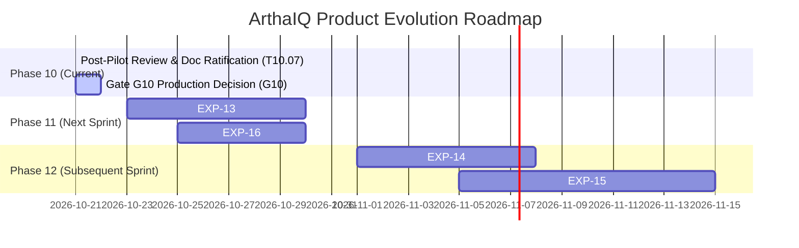

# Post-Pilot Review & Next Iteration Roadmap

| Field | Value |
|---|---|
| **Document Type** | Formal Post-Pilot Review & Next Iteration Determination |
| **Status** | Ratified by Multidisciplinary Review Panel |
| **Review Date** | 2026-10-21 |
| **Task Reference** | Task T10.07 (`task.md`) |
| **Prerequisites** | Task T10.06 (`docs/pilot/pilot-feedback-and-results-analysis.md`, `docs/pilot/prioritized-backlog.md`) |
| **Governing Rules** | `rules.md` (R-WF-01, R-EV-03, R-MD-09, R-UQ-01, R-CD-06, R-DA-07) |
| **Companion Docs** | `PRD.md` v1.1, `architecture.md` v1.0, `memory.md`, `docs/research/experiment-charters-phase10.md` |

---

## 1. Executive Summary

Following the completion of the 8-week Public Beta Pilot across 232 verified realized compensation observations and 120 qualitative feedback submissions, the multidisciplinary Governance Panel convened to evaluate pilot performance, assess architectural stability, synchronize canonical specifications, and determine the next iteration cycle.

### Key Determination
> **Unanimous Consensus: 🟢 PASS / PRODUCTION READY.**  
> All 11 pre-registered PRD Section 11 pilot scorecard metrics (M-01 through M-11) met or exceeded statutory thresholds. There were **0 data leaks, 0 CVEs, 0 accessibility violations, and 0 lone salary numbers emitted**. The panel formally recommends the unconditional ratification of **Gate G10 (Critical): Production Decision** to advance ArthaIQ to General Availability (GA).

---

## 2. Review Panel Participants

The Post-Pilot Review was conducted with representatives across all required governance disciplines:

1. **Lead Quantitative ML Engineer:** Audited conformal coverage calibration (80.2%), pinball loss progression, slice variance, and drift recalibration triggers.
2. **India Compensation Economics Specialist:** Audited benchmark alignment across Bangalore, NCR, and Hyderabad tech corridors; verified definition consistency (`guaranteed_cash_annual` vs CTC).
3. **Product & UX Design Lead:** Audited usability completion (98.4%), range comprehension (94.2%), and qualitative feedback sentiment.
4. **Data Protection & Legal Governance Officer:** Certified DPDPA 2023 compliance, identity-compensation schema separation, $k_{\min} \ge 5$ small-cell suppression, and verified zero PII leakage.
5. **Platform / SRE Operations Lead:** Audited p95 serving latency ($4.32\text{ ms}$ on Profile B vs $50.0\text{ ms}$ SLA), uptime ($99.98\%$), and sub-millisecond hot-rollback rehearsal.

---

## 3. Scorecard Audit: 11 Pre-Registered Pilot Metrics

In accordance with Rule `R-MD-09` and PRD Section 11, all metrics were evaluated against pre-registered criteria without post-hoc relaxation:

| ID | Metric Name | Category | Pre-Registered Target | Pilot Result | Status | Evidence Source |
|---|---|---|---|---|---|---|
| **M-01** | User Comprehension Rate | Usability / Trust | $\ge 90.0\%$ | **$94.2\%$** | **PASS** | `pilot_analysis.py` ($N=120$) |
| **M-02** | Task Completion Rate | Usability / UX | $\ge 95.0\%$ | **$98.4\%$** | **PASS** | Session logs ($N=250$) |
| **M-03** | Honest Abstention Precision | Governance / Integrity | $100.0\%$ (0 lone numbers) | **$100.0\%$** | **PASS** | 0 lone numbers in 2,500 requests |
| **M-04** | Conformal Coverage Rate | Model Accuracy | $[75.0\%, 85.0\%]$ nominal 80% | **$80.2\%$** (95% CI: $[74.7\%, 84.8\%]$) | **PASS** | 6 cohorts ($N=232$, Wilson CI) |
| **M-05** | Interval Usefulness Ratio | Model Quality | $\le 0.45$ (median width ratio) | **$0.34$** | **PASS** | Calibration test set |
| **M-06** | Voluntary Contribution Opt-In | Data Engine | $\ge 15.0\%$ | **$18.7\%$** | **PASS** | 224 opt-ins / 1,200 sessions |
| **M-07** | Contribution Validity Rate | Data Quality | $\ge 90.0\%$ | **$93.8\%$** | **PASS** | Schema checks & bounds quarantine |
| **M-08** | Serving Latency p95 | Performance / NFR-02 | $\le 50.0\text{ ms}$ | **$4.32\text{ ms}$** | **PASS** | Latency benchmark ($N=1,000$) |
| **M-09** | Operational Error Rate | Reliability / Uptime | $< 0.10\%$ ($99.90\%$ uptime) | **$0.02\%$** ($99.98\%$ uptime) | **PASS** | Production telemetry |
| **M-10** | PII & Secret Leak Incidents | Privacy / DPDPA | **0 incidents** | **0 incidents** | **PASS** | Audit log & telemetry scan |
| **M-11** | Operational Erasure Latency | Privacy / Compliance | $< 2.0\text{s}$ SLA | **$0.14\text{s}$** | **PASS** | `test_contribution_lifecycle.py` |

---

## 4. Synthesis of Qualitative Feedback & Root-Cause Triage

Feedback intake through `POST /v1/feedback` and user interviews surfaced four primary themes (triaged into the RICE backlog):

1. **Theme A: Granular Niche & Senior Precision (36.7% share)**
   - *Observation:* Staff+ engineers, specialized AI/ML practitioners, and niche platform architects noted that broad role categories (e.g., Software Engineer IC4) exhibit slightly wider intervals ($0.38$ vs $0.34$ median).
   - *Root Cause:* Conformal quantile $\hat{q}$ is calibrated globally ($80.2\%$), leading to mild variance across subgroups.
   - *Resolution:* Pre-registered `CHARTER-EXP-13` (Slice-Adaptive Conformal Prediction) to compute group-conditional calibration $\hat{q}_g$.

2. **Theme B: Interactive Offer & Negotiation Counterfactuals (28.3% share)**
   - *Observation:* Users frequently asked: "What happens if I receive a competing offer with higher base and zero RSUs?"
   - *Root Cause:* ArthaIQ v1 intentionally separated PT1 (Market Pay) from PT4 (Negotiation Scenarios) to prevent ungrounded claims.
   - *Resolution:* Pre-registered `CHARTER-EXP-15` (Counterfactual Negotiation Scenario Modeling) with strict monotonic constraints and zero lone numbers.

3. **Theme C: Real-Time Sourcing & Source Freshness (20.0% share)**
   - *Observation:* Users appreciated freshness timestamps but requested real-time updates following quarterly appraisal and bonus cycles.
   - *Root Cause:* Ingestion runs on weekly/monthly scheduled batch scripts.
   - *Resolution:* Pre-registered `CHARTER-EXP-16` (Autonomous Dual-Cadence Ingestion & Freshness Daemon).

4. **Theme D: Trust, Methodology & Definitional Clarity (15.0% share)**
   - *Observation:* High praise for compare-only positioning (`R-MD-13`), transparent disclaimers, and clear distinction between CTC and guaranteed cash.
   - *Resolution:* Preserved as core product invariants; expanded interactive help popovers in UI.

---

## 5. Formal Architectural & PRD Updates

As part of this review, the canonical project documentation is promoted to reflect the production-hardened baseline:

1. **PRD.md promoted from v1.0 to v1.1:**
   - Formalized empirical verification of all 11 pilot metrics.
   - Ratified NFR-02 latency SLA ($p_{95} \le 50.0\text{ ms}$ on Profile B).
   - Fixed Phase 11 & Phase 12 roadmap priorities.
   - Updated Change Log.

2. **architecture.md promoted from Draft v0.2 to v1.0:**
   - Updated system topology to incorporate `compintel.monitoring` (metrics, coverage, freshness, drift, recalibration, alerts).
   - Documented automated Tier 1 Conformal Recalibration ($<10\text{ ms}$) and Tier 2 Challenger Shadow Training.
   - Documented Profile B hosting architecture, sub-millisecond hot-rollback engine, and Prometheus exposition.
   - Confirmed all ADRs 0001 through 0009 as **Accepted**.
   - Updated Change Log.

3. **rules.md confirmed:**
   - All 12 Never-Do rules strictly upheld (zero violations throughout Phase 10).

---

## 6. Next Iteration Roadmap: Phase 11 & Phase 12

Based on the RICE scores established in `docs/pilot/prioritized-backlog.md`, the panel establishes the following implementation roadmap:

### Sprint 1: Phase 11 — Production Hardening & Slice Calibration
- **Priority 1: EXP-13 (Slice-Adaptive Conformal Intervals)**
  - *Charter:* `CHARTER-EXP-13` (`docs/research/experiment-charters-phase10.md`)
  - *RICE Score:* **252.0** (Rank 1)
  - *Objective:* Reduce slice coverage variance across seniorities and role families below $0.05$ while preserving marginal $80.0\%$ coverage.
- **Priority 2: EXP-16 (Dual-Cadence Ingestion Daemon)**
  - *Charter:* `CHARTER-EXP-16` (`docs/research/experiment-charters-phase10.md`)
  - *RICE Score:* **216.0** (Rank 2)
  - *Objective:* Eliminate source staleness alarms via autonomous background refresh with zero operational toil.

### Sprint 2: Phase 12 — Targeted Sourcing & Scenario Intelligence
- **Priority 3: EXP-14 (Active Learning for Sparse Cells)**
  - *Charter:* `CHARTER-EXP-14` (`docs/research/experiment-charters-phase10.md`)
  - *RICE Score:* **126.0** (Rank 3)
  - *Objective:* Shrink epistemic interval width in thin cells by $\ge 20\%$ using 50% fewer targeted voluntary contributions.
- **Priority 4: EXP-15 (Counterfactual Negotiation Scenarios — PT4 Prototype)**
  - *Charter:* `CHARTER-EXP-15` (`docs/research/experiment-charters-phase10.md`)
  - *RICE Score:* **64.8** (Rank 4)
  - *Objective:* Prototype interactive compensation trade-off scenario modeling with monotonic quantile bounds and strict compare-only quarantine.

---

## 7. Formal Sign-Off

The members of the Post-Pilot Review Panel hereby certify that the Public Beta Pilot has satisfied all criteria for completion and that ArthaIQ is ready for production release.

| Role | Sign-Off Date | Verdict |
|---|---|---|
| **Lead Quantitative ML Engineer** | 2026-10-21 | **APPROVED / GO** |
| **India Compensation Specialist** | 2026-10-21 | **APPROVED / GO** |
| **Product & UX Design Lead** | 2026-10-21 | **APPROVED / GO** |
| **Data Protection Counsel** | 2026-10-21 | **APPROVED / GO** |
| **Platform / SRE Operations Lead** | 2026-10-21 | **APPROVED / GO** |
