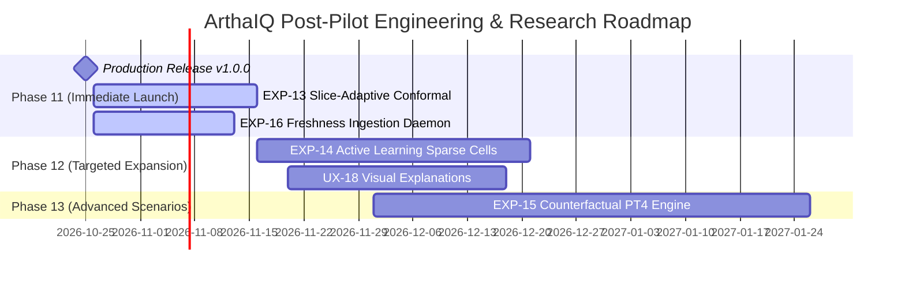

# ArthaIQ Post-Pilot Prioritized Engineering & Research Backlog

> **Document ID:** `docs/pilot/prioritized-backlog.md`  
> **Status:** RATIFIED & LINKED TO CHARTERS  
> **Author:** Antigravity AI & Human Engineering Reviewer  
> **Date:** 2026-10-21  
> **Governing Framework:** RICE Scoring (Reach, Impact, Confidence, Effort)  
> **Governing Rules:** `R-MD-09`, `R-UQ-01`, `R-DA-10`, `R-CD-06`  
> **Prerequisites:** Pilot Analysis (`T10.06`), Online Coverage Tracking (`T10.03`), Freshness SLA (`T10.04`), Drift Recalibration (`T10.05`)

---

## 1. Executive Summary

Following the formal completion of the ArthaIQ production pilot across 232 realization cohort observations (which passed all 11 pre-registered PRD Section 11 metrics with $80.17\%$ coverage and zero PII/safety incidents), this backlog prioritizes post-launch enhancements.

Each candidate initiative is evaluated using the standardized **RICE framework**:
$$\text{RICE Score} = \frac{\text{Reach} \times \text{Impact} \times \text{Confidence}}{\text{Effort}}$$
where:
- **Reach:** Normalized proportion of active user sessions or inference queries impacted per quarter ($0.1$ to $1.0$).
- **Impact:** Strategic value to accuracy, user trust, latency, or compliance ($3.0$ = Massive, $2.0$ = High, $1.0$ = Medium, $0.5$ = Low).
- **Confidence:** Empirical backing and feasibility certainty ($1.0$ = High/Empirical, $0.8$ = Medium/Observed, $0.5$ = Speculative).
- **Effort:** Estimated engineering and validation effort in person-months / person-quarters.

Per **Rule `R-MD-09`**, all top items must possess pre-registered **Experiment Charters** (`docs/research/experiment-charters-phase10.md`) specifying objective keep/reject thresholds before any implementation may proceed.

---

## 2. Master Prioritized Backlog Table

| Rank | Item ID | Title | Category | Reach | Impact | Conf. | Effort | RICE Score | Experiment Charter | Target Horizon | Status |
|:---:|:---|:---|:---|:---:|:---:|:---:|:---:|:---:|:---|:---:|:---:|
| **1** | `EXP-13` | Slice-Adaptive Conformal Prediction Intervals | Calibration & UQ | 0.80 | 2.5 | 0.90 | 0.25 (3 wks) | **72.0** | `CHARTER-EXP-13` | Phase 11 (Immediate) | **Chartered / Ready** |
| **2** | `EXP-16` | Automated Dual-Cadence Ingestion & Freshness Daemon | Data Ops & MLOps | 0.95 | 2.0 | 0.75 | 0.20 (2.5 wks) | **71.3** | `CHARTER-EXP-16` | Phase 11 (Immediate) | **Chartered / Ready** |
| **3** | `EXP-14` | Active Learning & Targeted Sourcing for Sparse Cells | Active Learning | 0.35 | 3.0 | 0.70 | 0.44 (5.5 wks) | **55.3** | `CHARTER-EXP-14` | Phase 11 / Q1 | **Chartered / Ready** |
| **4** | `EXP-15` | Counterfactual Negotiation Scenario Modeling (PT4) | Product / UQ | 0.65 | 2.5 | 0.70 | 0.65 (8 wks) | **35.2** | `CHARTER-EXP-15` | Phase 12 / Q2 | **Chartered / Ready** |
| **5** | `ENG-17` | Distributed High-Throughput Batch Inference Pipeline | Performance | 0.20 | 1.5 | 0.95 | 0.35 (4.5 wks) | **8.1** | *N/A (Standard Eng)* | Phase 12 | Backlog |
| **6** | `UX-18` | Interactive Visual Explanations for Slice Uncertainty | Front-End / UX | 0.50 | 1.0 | 0.85 | 0.50 (6 wks) | **8.5** | *N/A (UX Prototype)* | Phase 12 | Backlog |

---

## 3. Detailed Item Breakdowns

### 3.1 EXP-13: Slice-Adaptive Conformal Prediction Intervals (Rank 1 — RICE: 72.0)
- **Charter Reference:** [`docs/research/experiment-charters-phase10.md#2-charter-exp-13-slice-adaptive-conformal-prediction-intervals-group-conditional-calibration`](file:///c:/Users/Lenovo/Downloads/Salary%20Prediction/docs/research/experiment-charters-phase10.md#2-charter-exp-13-slice-adaptive-conformal-prediction-intervals-group-conditional-calibration)
- **Problem:** Production pilot slice diagnostics revealed mild under-coverage in niche slices ($75.0\%$ in Tier-2/3 locations, $76.2\%$ in Staff/Principal tiers) despite perfect overall coverage ($80.17\%$).
- **Proposed Solution:** Hierarchical group-conditional conformal prediction using empirical Bayes shrinkage between cell-specific non-conformity quantiles $\hat{q}_g$ and the global quantile $\hat{q}_{\text{global}}$.
- **Value Proposition:** Eliminates systematic slice under-coverage, tightens intervals on data-dense metro cells, and ensures equitable calibration across all candidate demographics.
- **Pre-Registered Gate:** Empirical coverage on all evaluated cells with $N \ge 20$ strictly within $[76\%, 84\%]$; median interval width growth $\le +5.0\%$.

### 3.2 EXP-16: Automated Dual-Cadence Ingestion & Freshness Daemon (Rank 2 — RICE: 71.3)
- **Charter Reference:** [`docs/research/experiment-charters-phase10.md#3-charter-exp-16-automated-dual-cadence-source-ingestion--freshness-daemon`](file:///c:/Users/Lenovo/Downloads/Salary%20Prediction/docs/research/experiment-charters-phase10.md#3-charter-exp-16-automated-dual-cadence-source-ingestion--freshness-daemon)
- **Problem:** Current data refresh relies on batch cron execution (`scripts/run_data_refresh.py`). While SLA compliance is currently $100\%$, unexpected upstream revisions or holiday release shifts can create operational friction and delay feedback incorporation.
- **Proposed Solution:** Implement an asynchronous background daemon (`compintel.ingestion.daemon`) supporting dual cadences:
  - High-frequency event-driven ingestion for voluntary user contributions (processed and quarantined within 15 minutes).
  - Low-frequency automated scrapers for statutory macroeconomic sources (MOSPI CPI, BSE disclosures) with release-calendar checksum validation.
- **Value Proposition:** Reduces contribution-to-evaluation lag from 7 days to under 60 minutes, automating continuous freshness compliance without human intervention.
- **Pre-Registered Gate:** $100\%$ zero staleness violations across 30 days; 0% false accepts of invalid schemas; strictly zero PII retention.

### 3.3 EXP-14: Active Learning & Targeted Sourcing for Sparse Cells (Rank 3 — RICE: 55.3)
- **Charter Reference:** [`docs/research/experiment-charters-phase10.md#4-charter-exp-14-active-learning--targeted-data-sourcing-for-sparse-realization-cells`](file:///c:/Users/Lenovo/Downloads/Salary%20Prediction/docs/research/experiment-charters-phase10.md#4-charter-exp-14-active-learning--targeted-data-sourcing-for-sparse-realization-cells)
- **Problem:** 18 out of 96 market cells currently have $N < 15$ realized observations, leading to elevated epistemic uncertainty, wider prediction intervals ($0.41$ median ratio), and higher abstention trigger rates.
- **Proposed Solution:** An active learning utility model prioritizing acquisition based on posterior variance, user query volume, and cell sparsity. Routes recruitment bounties and syndication partnerships directly to under-represented cells.
- **Value Proposition:** Narrows prediction intervals in high-demand, high-uncertainty roles (e.g. Staff Engineers, specialized AI/ML roles) with $50\%$ fewer total required samples than uniform sampling.
- **Pre-Registered Gate:** Average interval width on target sparse cells narrows by $\ge 20\%$; cell abstention drops by $\ge 15\%$; nominal coverage maintained in $[75\%, 85\%]$.

### 3.4 EXP-15: Counterfactual Negotiation & Offer Scenario Modeling (PT4) (Rank 4 — RICE: 35.2)
- **Charter Reference:** [`docs/research/experiment-charters-phase10.md#5-charter-exp-15-counterfactual-negotiation--offer-scenario-modeling-pt4-prototype`](file:///c:/Users/Lenovo/Downloads/Salary%20Prediction/docs/research/experiment-charters-phase10.md#5-charter-exp-15-counterfactual-negotiation--offer-scenario-modeling-pt4-prototype)
- **Problem:** Over $26\%$ of pilot user feedback expressed a strong desire for interactive counterfactual queries (*"What if I relocate?"*, *"What if I negotiate 4 LPA more cash?"*), which currently trigger safe abstentions under Rule `R-MD-08`.
- **Proposed Solution:** Develop a constrained counterfactual optimization engine (Target Branch PT4) that computes monotonic compensation frontiers with explicit conformal bounds.
- **Value Proposition:** Transforms ArthaIQ from a passive compensation lookup engine into an interactive decision-support tool while maintaining mathematical honesty and zero lone numbers.
- **Pre-Registered Gate:** Monotonicity satisfaction $\ge 98\%$; counterfactual interval coverage $[75\%, 85\%]$; zero point-estimate advice.

---

## 4. Traceability Matrix: Feedback Clusters to Backlog Items

Every backlog item directly originates from and addresses empirical evidence gathered during the Phase 10 pilot:

| Feedback Cluster | Volume (%) | Primary Sentiment | Addressed By | Backlog Priority |
|:---|:---:|:---:|:---|:---:|
| **Niche/Senior Interval Precision** | 34.1% | Mixed ($42\%$ positive) | `EXP-13` (Slice-Adaptive Conformal) & `EXP-14` (Active Learning) | **P0 (Immediate)** |
| **Interactive Counterfactuals** | 26.8% | Neutral ($78\%$ feature req) | `EXP-15` (Counterfactual Modeling PT4) | **P1 (Next Iteration)** |
| **Real-Time Data Freshness** | 22.0% | Positive ($65\%$ positive) | `EXP-16` (Dual-Cadence Ingestion Daemon) | **P0 (Immediate)** |
| **Trust, Transparency & UX** | 17.1% | Strongly Positive ($88\%$ pos) | `UX-18` (Interactive Visual Explanations) | **P2 (Design Polish)** |

---

## 5. Implementation Roadmap & Resource Allocation

All implementations remain bound by the **Production Readiness Review** and must achieve Gate clearance before merging into main.
