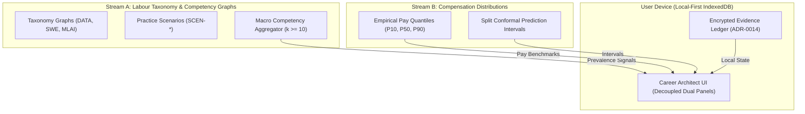

# Macroeconomic Competency Aggregation & Privacy Specification

| Document ID | SPEC-MACRO-COMP-01 |
|---|---|
| Status | **Approved** |
| Version | 1.0.0 |
| Date | 2026-11-01 |
| Phase / Task | Phase 27 / Task T27.04 |
| Relates to | `rules.md` R-CR-01, R-CR-02, R-CR-09, R-CR-12, R-SC-01; ADR-0011, ADR-0012, ADR-0014; India DPDP Act 2023 |

---

## 1. Executive Summary & Purpose

The ArthaIQ Macroeconomic Competency Aggregator synthesizes market-wide occupational skill prevalence, transition velocity, and capability demand trends across the Indian technology ecosystem (Bengaluru, Hyderabad, Pune, NCR, MMR).

In strict adherence to ArthaIQ's constitutional invariants:
1. **Zero Lone Numbers (`R-UQ-01`):** All aggregate statistical summaries report full empirical distributions ($P_{10}, P_{50}, P_{90}$) and sample counts.
2. **Two Streams, Two Places (`R-CR-02`):** Macroeconomic competency demand signals and compensation distributions remain completely separate entities. There are zero composite "skill-to-pay multiplier" scores.
3. **Local-First Zero-Knowledge (`R-CR-12`, `ADR-0014`):** Aggregation never queries raw client-side evidence ledgers. All ingested signals derive from opt-in, differentially private, zero-knowledge telemetry or public labour market taxonomies.
4. **No Causal Compensation Promises (`R-CR-01`):** Macroeconomic skill demand trends never claim that acquiring a specific competency increases remuneration by ₹X.

---

## 2. Privacy & Anonymity Guarantees

### 2.1 Strict $k$-Anonymity Floor ($k \ge 10$)

To prevent re-identification of individual practitioners or niche enterprise teams:
- Any reporting cell stratified by $(\text{RoleFamily}, \text{SeniorityLevel}, \text{MetroCluster}, \text{CompetencyID})$ must have a cohort size of at least:
  $$\text{Cohort Size } N \ge 10$$
- If $N < 10$, the cell is suppressed entirely (`status: "SUPPRESSED_SPARSE_CELL"`) or coarsened to the next geographic/seniority tier.

### 2.2 Differential Privacy & Noise Addition

When publishing aggregated competency prevalence frequencies:
- A Laplace mechanism with privacy budget $\epsilon = 0.5$ and sensitivity $\Delta = 1/N$ is applied to relative frequency estimates:
  $$\hat{f} = \frac{\sum_{i=1}^N x_i}{N} + \text{Lap}\left(0, \frac{\Delta}{\epsilon}\right)$$
- Counts are clamped to $[0, N]$ and normalized so relative probabilities sum to 1.0.

### 2.3 Decoupled Two-Stream Architecture



Macroeconomic competency telemetry cannot be joined with individual salary records on the server. The client UI renders competency gap analysis in one view and market compensation distributions in a separate, isolated panel.

---

## 3. Geographic Stratification & Metro Clusters

Data is aggregated across five Tier-1 Indian technology hubs:
1. **BLR (Bengaluru Urban & Rural):** Outer Ring Road, Whitefield, Electronic City.
2. **HYD (Hyderabad):** Hitec City, Gachibowli, Financial District.
3. **PUN (Pune):** Hinjewadi, Magarpatta, Kharadi.
4. **NCR (Delhi National Capital Region):** Gurugram (Cyber City, Golf Course Ext), Noida (Sector 62, 135).
5. **MMR (Mumbai Metropolitan Region):** BKC, Powai, Navi Mumbai (Airoli).

Cells with cross-metro or remote work patterns are aggregated under `REMOTE_INDIA` if $N \ge 10$.

---

## 4. Aggregate Schema Definition

```json
{
  "$schema": "https://json-schema.org/draft/2020-12/schema",
  "title": "MacroeconomicCompetencyReport",
  "type": "object",
  "required": [
    "report_id",
    "generated_at_utc",
    "role_family",
    "metro_cluster",
    "k_anonymity_floor",
    "total_cohort_size",
    "competency_metrics",
    "disclaimer"
  ],
  "properties": {
    "report_id": { "type": "string", "pattern": "^MACRO-[A-Z0-9_-]+$" },
    "generated_at_utc": { "type": "string", "format": "date-time" },
    "role_family": { "type": "string", "enum": ["DATA", "SWE", "MLAI"] },
    "metro_cluster": { "type": "string", "enum": ["BLR", "HYD", "PUN", "NCR", "MMR", "REMOTE_INDIA"] },
    "k_anonymity_floor": { "type": "integer", "minimum": 10 },
    "total_cohort_size": { "type": "integer", "minimum": 10 },
    "competency_metrics": {
      "type": "array",
      "items": {
        "type": "object",
        "required": ["competency_id", "sample_count", "prevalence_ratio", "status"],
        "properties": {
          "competency_id": { "type": "string" },
          "sample_count": { "type": "integer", "minimum": 10 },
          "prevalence_ratio": { "type": "number", "minimum": 0.0, "maximum": 1.0 },
          "status": { "type": "string", "enum": ["VALID", "SUPPRESSED_SPARSE_CELL"] }
        }
      }
    },
    "disclaimer": {
      "type": "string",
      "description": "Statutory notice under Consumer Protection Act 2019 and Rule R-CR-01."
    }
  }
}
```

---

## 5. Compliance & Statutory Governance

1. **India DPDP Act 2023:**
   - Section 3(c): Anonymized macro data is fully exempt from data protection obligations once mathematically decoupled from natural persons.
   - Section 6(1): Opt-in telemetry collection requires explicit, unbundled affirmative consent.
2. **Competition Commission of India (CCI) Safe Harbors:**
   - Aggregated figures must never report employer-specific salary or competency distributions.
   - Historical window minimum: Telemetry reflects rolling 90-day historical aggregates to prevent current algorithmic wage signaling or anti-competitive coordination.
